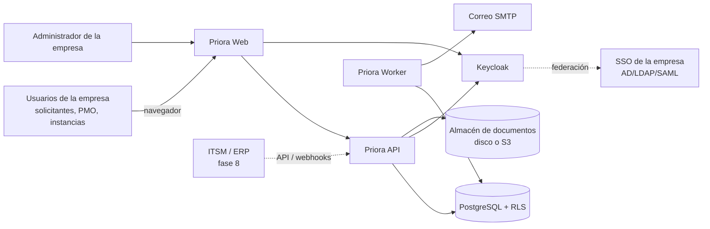
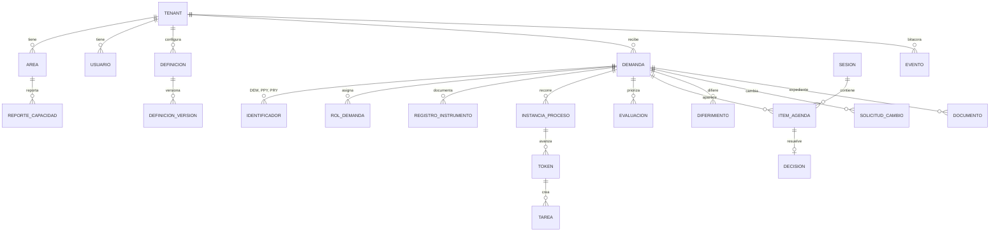

# Arquitectura · Priora

> Mapa técnico del sistema. Principios, stack con licencias y reglas: `docs/fase0/base-tecnica.md`. Decisiones: `docs/adr/`. Este archivo se actualiza cuando cambia la estructura (lo hace el subagente `documentador`).

## 1. Contexto



## 2. Contenedores

| Contenedor | Tecnología | Responsabilidad |
| --- | --- | --- |
| `apps/web` | Next.js | Interfaz, formularios dinámicos, diagramas, tableros |
| `apps/api` | NestJS | API REST `/api/v1`, OpenAPI, autenticación, casos de uso |
| `apps/worker` | Node + pg-boss | Temporizadores, vencimientos, notificaciones, refresco de indicadores, outbox |
| PostgreSQL | — | Datos de negocio, configuración versionada, bitácora, colas |
| Keycloak | — | Identidad, SSO, roles de plataforma |
| Mailpit (dev) / SMTP | — | Correo |

## 3. Módulos (`modules/`)

| Módulo | Responsabilidad | Fase |
| --- | --- | --- |
| `acceso` | Políticas de autorización del proceso (`puede(...)`) | 0 |
| `auditoria` | Bitácora append-only de eventos de negocio y configuración | 0 |
| `empresas` | Empresa, marca, calendario, identificadores, módulos activos | 1 |
| `organizacion` | Áreas, usuarios, roles funcionales, asignaciones | 1 |
| `configuracion` | Plantillas: importar, exportar, versionar, validar coherencia; taxonomía, estrategia, gobierno (datos) | 1 |
| `flujos` | Definiciones, instancias, tokens, tareas, temporizadores; usa `packages/workflow-engine` | 2 |
| `instrumentos` | Definiciones de formularios, registros, versiones, firmas | 2 |
| `expediente` | Documentos, clasificación de acceso, almacenamiento | 2 |
| `notificaciones` | Plantillas, envío, preferencias | 2 y 6 |
| `demandas` | Demanda, identificadores, vínculos, seguimiento, canal único, duplicados | 3 |
| `clasificacion` | Árbol de clasificación, precedencia de categorías, verificación normativa | 3 |
| `priorizacion` | Modelos, evaluaciones, reglas de decisión | 4 |
| `capacidad` | Reportes, consolidado, conflictos de capacidad | 4 |
| `gobierno` | Sesiones, agenda, quórum, decisiones, actas, revisión ejecutiva, diferidos | 4 |
| `cambios` | Solicitudes de cambio por magnitud | 4 y 5 |
| `seguimiento` | Plazos, semáforo, indicadores, tableros, exportaciones | 6 |

Reglas de dependencia (dependency-cruiser): `domain` no importa nada externo; un módulo usa a otro solo por su `application` pública o por eventos; `packages/workflow-engine` es puro y no conoce módulos.

## 4. Modelo de datos (simplificado)



- `DEFINICION` es genérica por `tipo`: flujo, instrumento, árbol, modelo de priorización, tabla de plazos, plantilla de notificación. El contenido versionado va en JSONB validado con el esquema de su tipo.
- `REGISTRO_INSTRUMENTO.datos` es JSONB; los campos marcados `nucleo` se copian a columnas tipadas de `DEMANDA` para filtros e índices.
- Toda tabla lleva `tenant_id` con RLS forzada. `EVENTO` es append-only (trigger impide update/delete).
- Indicadores: vistas materializadas sobre `EVENTO` y tablas operativas.

## 5. Recorrido de una petición

1. La web envía el token OIDC → la API lo valida contra Keycloak.
2. Un interceptor resuelve la empresa desde el token y abre una transacción con `set_config('app.tenant_id', …, true)`.
3. El caso de uso consulta políticas (`acceso`) y ejecuta dominio puro.
4. Si el dominio pide efectos (notificar, programar temporizador), se escriben en el outbox en la misma transacción; el worker los ejecuta con el mismo `tenant_id`.
5. Se registra el evento en la bitácora; logs y trazas llevan `tenant_id`.

## 6. Estructura de carpetas

```
priora/
├── PRD.md · ARCHITECTURE.md · CLAUDE.md · TODO.md · FASE0.md
├── apps/{api,worker,web}
├── modules/<modulo>/{domain,application,infrastructure,interface}
├── packages/{workflow-engine,contracts,ui,config}
├── plantillas/{marco-tic-banca,generica-simple}
├── infra/{keycloak,compose}            # fase 8: helm/, tofu/
├── scripts/                            # utilidades en Node (multiplataforma)
├── docs/{fase0,fases,specs,adr,referencia,security,releases}
└── .claude/{agents,commands,hooks,settings.json}
```

## 7. Integraciones

| Integración | Cuándo | Cómo |
| --- | --- | --- |
| SSO corporativo | Fase 0 (Keycloak), federación por cliente | SAML / OIDC / LDAP en Keycloak |
| Correo | Fase 2 | SMTP |
| Almacén de documentos | Fase 2 (disco), fase 8 (S3) | Puerto `AlmacenDocumentos` |
| ITSM / ERP | Fase 8 | API REST + webhooks salientes |
| Firma electrónica de actas | Fase 8 | Por definir (proveedor ecuatoriano) |
| IA | Fase 9 (opcional) | Puerto `AsistenteIA` + LiteLLM |
