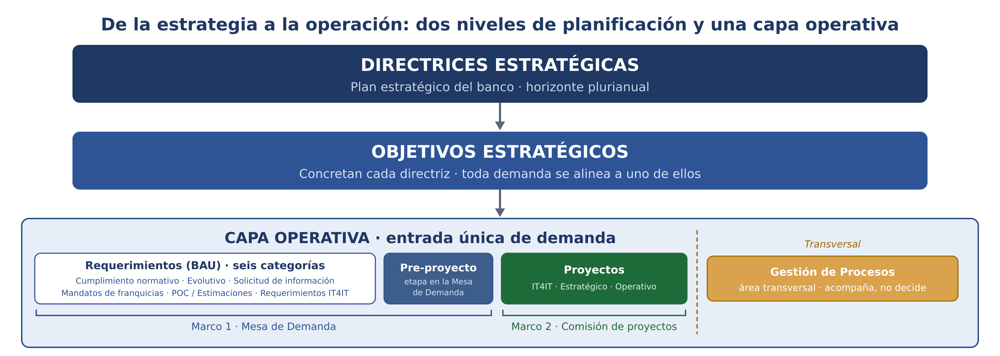

# 2. Principios rectores

| **Principio** | **Aplicación en el banco** |
|---|---|
| Entrada única, rutas diferenciadas | Existe un solo punto de entrada para toda la demanda tecnológica. El área solicitante registra una sola vez y la organización clasifica y enruta. |
| Gobierno proporcional al riesgo | Un evolutivo acotado no debería pasar por la misma instancia que una modernización del core. |
| Mínimo papeleo viable | Cada formulario y cada campo deben justificar su existencia. |
| Alineación a objetivos estratégicos | Toda demanda, sin excepción, desde el requerimiento más pequeño hasta el proyecto, debe indicar a qué objetivo estratégico del plan del banco contribuye (ver 2.1). |
| Capacidad finita visible | La priorización considera presupuesto, disponibilidad de equipos, proveedores, ventanas de cambio y capacidad del negocio para adoptar. La PMO la hace visible en cada sesión con la matriz de capacidades (9.17). Sin el reporte de un área no se prioriza, salvo una obligación externa con fecha límite (7.4). |
| Sustento económico y verificación de beneficios | El Área Financiera realiza análisis económicos y financieros de las inversiones, no valida viabilidad, participa en su aprobación y verifica al cierre que los beneficios proyectados se hayan cumplido (ver 8.2 y secciones 6 y 10). |
| Las áreas especializadas acompañan, la instancia de gobierno decide | Seguridad Bancaria, Gestión de Procesos, Cumplimiento, Arquitectura y Riesgos participan con voz experta, y Legal y Talento Humano lo hacen por invitación cuando se activa su disparador (6.7); ninguna aprueba ni veta. Las únicas excepciones declaradas son el pronunciamiento del oficial de protección de datos en los supuestos de 9.13 y la revisión de la VPEG (8.1), ambos vinculantes, y la observación crítica abierta en la certificación, que impide el pase a producción hasta que se resuelva (5.7). |
| Beneficios medibles | Si un pre-proyecto no puede expresar un beneficio que se pueda medir después, no debería competir por inversión. |
| Decidir con datos comparables | La prioridad se sustenta en un puntaje homogéneo y trazable. |

**Una sola entrada, sin excepciones.** El principio más importante de este marco es que toda la demanda tecnológica entra por un único punto de registro, sin importar de quién provenga ni qué tan urgente parezca. No hay entradas paralelas: ni el correo directo a un técnico, ni el mensaje al jefe de sistemas, ni el pedido «de pasillo» son vías válidas.

## 2.1 Niveles de planificación: directrices estratégicas, objetivos estratégicos y capa operativa

La gestión de la demanda tecnológica solo tiene sentido si se conecta con la estrategia del banco. Por eso este marco se apoya en una lógica de planificación en cascada (reconocida en COBIT 2019 como la traducción de objetivos de la empresa en objetivos de tecnología, y en la disciplina de gestión de portafolios del PMI) en la que cada nivel da propósito y justificación al nivel inferior, y cada nivel inferior es la evidencia de ejecución del superior. Son tres niveles: dos de planificación (directrices estratégicas y objetivos estratégicos) y uno de ejecución (la capa operativa).

**Directrices estratégicas.** Son las grandes apuestas del banco a varios años: las direcciones de cambio que la alta dirección define en el plan estratégico institucional y que responden a la pregunta «¿en qué queremos convertirnos como banco?». Una directriz estratégica no se ejecuta directamente, no es un proyecto ni tiene presupuesto propio; expresa una intención de largo plazo (por ejemplo, liderazgo en banca digital, excelencia operativa o crecimiento en un segmento) que orienta y prioriza todo lo que viene debajo. Su horizonte es plurianual y su dueño es el nivel ejecutivo más alto. Cumplen la función de norte estratégico: cualquier inversión que no pueda rastrearse hasta una directriz estratégica es, por definición, una inversión sin justificación estratégica.

**Objetivos estratégicos.** Son el puente entre la intención de las directrices estratégicas y el trabajo concreto. Cada directriz estratégica se descompone en un número acotado de objetivos estratégicos: resultados de negocio definidos y medibles que el banco se propone alcanzar, todavía de alcance amplio y horizonte plurianual. Un objetivo estratégico responde a «¿qué tenemos que lograr para avanzar en esta directriz estratégica?» y se mide por resultados de negocio (cuota de mercado, reducción de costo, satisfacción del cliente, cumplimiento), no por entregables tecnológicos. No tiene presupuesto ni equipo propios: se materializa a lo largo del tiempo a través de muchos proyectos y requerimientos evolutivos que comparten ese propósito común. Es el nivel donde la estrategia se vuelve accionable sin perder todavía la visión de conjunto, y es el punto de anclaje que este marco usa para priorizar: toda demanda relevante debe poder nombrar a qué objetivo estratégico contribuye.

**Capa operativa.** Es el nivel de ejecución, donde la estrategia se convierte en trabajo real y entregable. Aquí vive la demanda que este marco clasifica y gobierna, en dos grupos (sección 4): los requerimientos (BAU), que son la operación del día a día en seis categorías, y los proyectos, en tres categorías, cada grupo con su nivel de gobierno proporcional a su impacto y riesgo. Entre los requerimientos, el Evolutivo merece mención aparte: es la mejora continua e incremental de capacidades que ya existen y están en producción (ajustes funcionales, optimizaciones y nuevas prestaciones sobre sistemas vigentes) que, sin alcanzar el tamaño de un proyecto, mantiene el software alineado con las necesidades cambiantes del negocio. Es el mecanismo por el cual un objetivo estratégico sigue avanzando entre proyecto y proyecto: mucho del progreso real hacia un objetivo del plan ocurre como una sucesión de evolutivos bien dirigidos, no solo como grandes inversiones puntuales. A diferencia de los dos niveles superiores, la capa operativa sí consume recursos concretos (personas, presupuesto, ventanas de cambio) y produce resultados verificables. Atravesándola de forma transversal está Gestión de Procesos, que acompaña la ejecución sin ser un grupo ni una categoría de demanda. La capa operativa es, en última instancia, la evidencia de que la estrategia se está cumpliendo: si las directrices estratégicas y los objetivos estratégicos no se reflejan en la demanda que efectivamente se prioriza y ejecuta aquí, la estrategia es solo declarativa.

*Figura 1. Niveles de planificación del banco y capa operativa. Elaboración propia.*

**Cómo se usa en la práctica:** en este marco toda demanda, sin excepción, declara a qué objetivo estratégico contribuye, desde el pre-proyecto y el proyecto de mayor inversión hasta el requerimiento más pequeño. Esa contribución es el primer criterio del scoring (sección 7) para la demanda que se prioriza, y un dato de registro obligatorio en la ficha 9.1 para toda la demanda registrada, sin importar a qué marco pertenezca. La razón es de fondo: la demanda que gestiona esta metodología no es soporte técnico genérico ni atención de fallas (eso corresponde a la gestión de incidentes de TIC, que queda fuera de este marco), sino el conjunto de cambios y evoluciones que el banco introduce deliberadamente en sus sistemas para avanzar en su transformación. Un ajuste en un canal, una parametrización o una nueva configuración no son neutrales respecto de la estrategia: habilitan, sostienen o mejoran alguna capacidad que sirve a un objetivo estratégico. Exigir que cada demanda nombre esa conexión obliga a que ningún esfuerzo tecnológico, por pequeño que sea, se ejecute sin un porqué estratégico explícito, y permite al banco ver, sumando toda la demanda, cuánto de su capacidad se está invirtiendo realmente en cada objetivo del plan.

**Una precisión de vocabulario:** en este marco conviven dos conceptos que deben distinguirse siempre. El *objetivo estratégico* es un elemento del plan del banco (nivel de planificación): un resultado de negocio plurianual que el banco se propone alcanzar, sin presupuesto propio. El *pre-proyecto* es una etapa de la demanda de este marco que se gestiona en Marco 1: un proyecto todavía sin presupuesto ni acta, candidato a aprobarse como tal (4.1). La Mesa de Demanda lo valida y, si corresponde, lo eleva a Marco 2. Un pre-proyecto se alinea a un objetivo estratégico (del plan); no son lo mismo.

### 2.1.1 Objetivo estratégico y Proyecto Estratégico: no son lo mismo

Proyecto Estratégico es una de las tres categorías de proyecto del marco (sección 4). La confusión más frecuente en la práctica es llamar así a lo que en realidad es un objetivo estratégico del plan, o viceversa. Este marco usa los dos términos con precisión porque mezclarlos genera decisiones de gobierno incorrectas.

| **Aspecto** | **Objetivo estratégico** | **Proyecto Estratégico** |
|---|---|---|
| **Qué es** | Un resultado de negocio que el banco se propone alcanzar, definido en el plan estratégico. No tiene presupuesto propio ni equipo asignado: es la dirección hacia la que apunta la inversión durante un período plurianual. | Un proyecto concreto, aprobado por la Comisión de proyectos, con presupuesto, acta de constitución, PM de proyecto, cronograma y entregables, que impulsa los objetivos estratégicos del banco con alto impacto en el negocio. Es la ejecución real del trabajo. |
| **Quién lo define** | La alta dirección del banco en el ejercicio de planificación estratégica. No se origina en Medios Tecnológicos, ni en los requerimientos (BAU), ni en la transformación estratégica. | Cualquier área solicitante, a través del canal único. La Mesa de triage le asigna la categoría al clasificarlo (4.4). Por regla general llega como pre-proyecto validado por la Mesa de Demanda (4.1); lo aprueba la Comisión de proyectos. |
| **Duración** | Plurianual (típicamente 2 a 5 años). No tiene fecha de cierre precisa. | Definida y acotada. Tiene fecha de inicio, hitos y fecha de cierre. |
| **Relación entre ambos** | Un objetivo estratégico se concreta a través de muchos proyectos, de cualquier categoría, y de requerimientos (BAU) ejecutados a lo largo del tiempo. | Contribuye de forma directa y crítica a un objetivo estratégico nombrado. Los Proyectos Operativos e IT4IT también se alinean a un objetivo, pero de forma indirecta o parcial. Esa alineación es el primer criterio del scoring (7.1) y se declara en el acta (9.5). |

**Ejemplo concreto:**

- **Objetivo estratégico:** «Liderazgo en banca digital», objetivo de 3 años del plan. Sin presupuesto propio ni fecha de entrega.

- **Proyectos que la ejecutan:** el rediseño de la app móvil (PRY-2025-012) y el onboarding digital (PRY-2025-031), clasificados como Proyectos Estratégicos porque son decisivos para ese objetivo; y la actualización del motor de notificaciones a clientes (PRY-2026-009), que también contribuye, pero de forma parcial, y se clasifica como Proyecto Operativo.

**Regla práctica:** cuando alguien dice «esto es estratégico», la pregunta correcta no es «¿entonces lo saltamos a la alta dirección?» sino «¿a cuál objetivo estratégico del plan contribuye y con qué calificación?». La categoría Proyecto Estratégico la asigna la Mesa de triage por esa contribución, no por quién lo pide, y no cambia la instancia que decide: todos los proyectos los aprueba la Comisión de proyectos.

