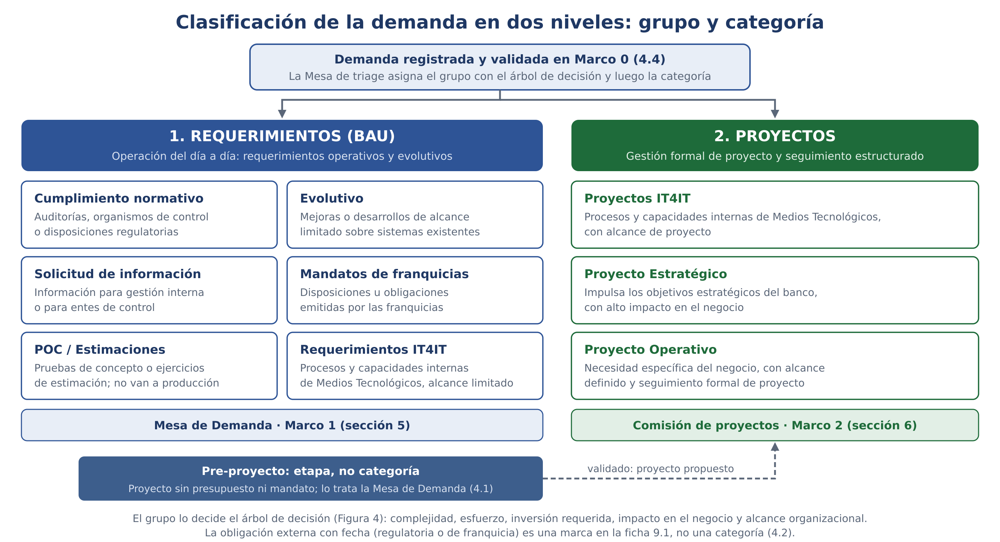
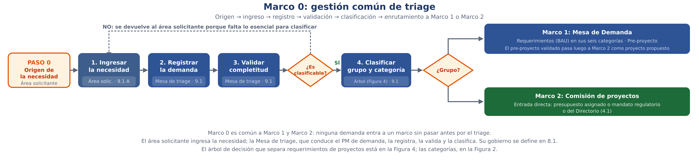
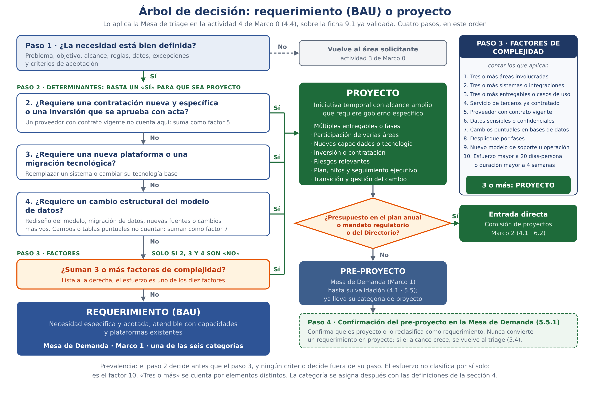

# 4. Taxonomía de demanda TIC y gestión común de triage

La taxonomía clasifica toda la demanda en dos niveles. El primero es el grupo: Requerimientos (BAU, del inglés business as usual, la operación del día a día) o Proyectos. El grupo define qué instancia gobierna la demanda y con qué nivel de control. El segundo es la categoría, que indica la naturaleza de la demanda dentro de su grupo: seis categorías para los requerimientos y tres para los proyectos. La categoría sirve para aplicar reglas particulares, ordenar la priorización y medir la composición de la demanda.

El grupo no se decide por el tema sino por la complejidad: el esfuerzo, la inversión requerida, el impacto en el negocio y el alcance organizacional. La Mesa de triage lo determina con el árbol de decisión de 4.4 (Figura 4). Los incidentes tecnológicos se excluyen de esta taxonomía; se gestionan por el área de Medios Tecnológicos según el marco normativo interno del banco.

*Figura 2. Clasificación de la demanda en dos niveles: grupo y categoría. Elaboración propia sobre la propuesta de estandarización de la clasificación de iniciativas de la PMO del banco.*

| **Grupo** | **Qué comprende** | **Instancia y marco** | **Gobierno mínimo** |
|---|---|---|---|
| **1. Requerimientos (BAU)** | Requerimientos operativos y evolutivos que forman parte de la gestión continua del banco: necesidades específicas y acotadas, atendibles con capacidades y plataformas existentes. | Mesa de Demanda · Marco 1 (sección 5). | Ficha 9.1 e historia de usuario (9.4), priorización en la Mesa de Demanda y backlog de requerimientos. Sin acta ni presupuesto de inversión propio. |
| **2. Proyectos** | Iniciativas que requieren una gestión formal de proyecto y un seguimiento estructurado: alcance amplio, varios entregables o fases, inversión o contratación, riesgos relevantes. | Comisión de proyectos · Marco 2 (sección 6). Llegan como pre-proyecto validado por la Mesa de Demanda o por entrada directa (4.1). | Caso de negocio (9.3), acta (9.5), plan, sponsor, PM de proyecto, control de cambios y seguimiento de beneficios. |

### Categorías del grupo Requerimientos (BAU)

| **Categoría** | **Qué comprende** | **Regla particular** | **Ejemplo bancario** |
|---|---|---|---|
| **Cumplimiento normativo** | Requerimientos originados por auditorías, organismos de control o disposiciones regulatorias. | Se registra la norma, el informe o el hallazgo que lo origina. Si el regulador fija una fecha, esa fecha no se negocia (7.3). | Ajuste de un reporte para la Superintendencia de Bancos; corrección de una observación de auditoría en un sistema. |
| **Evolutivo** | Modificaciones, mejoras o desarrollos de alcance limitado sobre sistemas existentes y en producción. | Es la categoría de la mejora continua. Si el alcance crece hasta responder «sí» a alguna pregunta del árbol, se reclasifica (5.4). | Agregar un campo calculado a una pantalla; ajustar una validación en originación digital. |
| **Solicitud de información** | Requerimientos de información de las áreas solicitantes para su gestión interna o para atender a entes de control. | Consulta o extracción sobre datos existentes, sin cambiar sistemas. A futuro se centraliza en Gobierno de Datos. | Extracción de cartera por segmento para Riesgos; base de datos pedida por un ente de control. |
| **Mandatos de franquicias** | Requerimientos originados por disposiciones u obligaciones emitidas por las franquicias de tarjetas con las que opera el banco. | Se registra el mandato y su fecha límite. Esa fecha no se negocia; lo gestiona y decide la Mesa de Demanda (7.3). | Cambio de reglas de autorización o del formato de mensajería exigido por una franquicia. |
| **POC / Estimaciones** | Pruebas de concepto o ejercicios de estimación solicitados por las áreas solicitantes, Administración o Medios Tecnológicos. | Plazo acotado y objetivo declarado: la hipótesis que se prueba o la pregunta que se estima. No pasa a producción. Al cerrar, su resultado se descarta o se registra como una demanda nueva vinculada. Método en 5.6. | Probar un motor OCR con una muestra de documentos; estimar el esfuerzo de migrar un módulo para el plan anual. |
| **Requerimientos IT4IT** | Iniciativas de alcance limitado orientadas a mejorar y fortalecer los procesos y capacidades internas de Medios Tecnológicos. | El área solicitante es Medios Tecnológicos (Paso 0, 4.4). El nombre proviene del modelo de referencia IT4IT de The Open Group. | Automatizar un paso del despliegue; actualizar una herramienta de monitoreo. |

### Categorías del grupo Proyectos

| **Categoría** | **Qué comprende** | **Regla particular** | **Ejemplo bancario** |
|---|---|---|---|
| **Proyectos IT4IT** | Iniciativas orientadas a mejorar y fortalecer los procesos y capacidades internas de Medios Tecnológicos, con alcance de proyecto. | El sponsor suele ser el CIO. Compite por capacidad e inversión como cualquier otro proyecto. | Renovación de la plataforma de monitoreo; migración del centro de datos. |
| **Proyecto Estratégico** | Iniciativas que impulsan los objetivos estratégicos del banco, con alto impacto en el negocio. | Contribuye de forma directa y crítica a un objetivo estratégico nombrado del plan. No es lo mismo que el objetivo estratégico (2.1.1). | Nueva plataforma de originación digital; onboarding digital. |
| **Proyecto Operativo** | Iniciativas que responden a necesidades específicas del negocio, con un alcance definido y un seguimiento formal de proyecto. | Contribuye a un objetivo estratégico de forma indirecta o parcial. No confundir con los requerimientos (BAU): es un proyecto completo, con acta, presupuesto y PM de proyecto. | Optimización de cobranzas; migración de una plataforma vigente. |

**Obligación externa con fecha: una marca, no una categoría.** Algunas demandas responden a una obligación cuya fecha fija un tercero: el regulador, un organismo de control o una franquicia. En los requerimientos, esa naturaleza ya la expresan sus categorías (Cumplimiento normativo y Mandatos de franquicias). En los proyectos no hay categoría propia: un proyecto originado por una norma se clasifica como IT4IT, Estratégico u Operativo según su naturaleza y lleva la marca de obligación externa en la ficha 9.1. La marca no crea categorías nuevas. La cartera regulatoria consolidada (7.3) se alimenta del origen normativo verificado, que se explica en 4.2.

**Referencia de esfuerzo.** Lo habitual en un requerimiento es un esfuerzo de hasta 20 días-persona y una duración de hasta 4 semanas. La referencia no clasifica por sí sola: superarla es el factor de complejidad 10 del árbol de decisión (4.4) y suma igual que cualquier otro factor. Una demanda de 45 días-persona sin otros factores sigue siendo requerimiento; con dos factores más, es proyecto.

**Presupuesto en Marco 1.** La expresión «sin presupuesto de inversión propio» de los requerimientos se refiere a un presupuesto formal con acta de constitución. No impide que la Mesa de Demanda apruebe el gasto con proveedor de un requerimiento, por ejemplo con cargo a un contrato vigente que fija un monto para cambios de ese tipo (8.1).

## 4.1 Qué es un pre-proyecto y cómo evoluciona a proyecto

**Definición.** El pre-proyecto no es un grupo ni una categoría: es la etapa en que está una demanda del grupo Proyectos que todavía no tiene presupuesto formal aprobado ni acta de constitución. Nace cuando el árbol de decisión clasifica la demanda como proyecto y no se cumple ninguna condición de entrada directa, y ya lleva su categoría de proyecto (IT4IT, Estratégico u Operativo). Es el espacio de análisis entre «esto parece importante» y «esto es un proyecto». Existe para evitar dos errores opuestos: aprobar inversiones sin haberlas entendido, o tratar como trámite operativo algo que en realidad requiere sponsor y presupuesto.

**De qué depende que un pre-proyecto se convierta en proyecto (Marco 2).** La conversión no es una decisión de oportunidad sino el resultado de confirmar, con el análisis de la ficha de pre-proyecto (9.3), las señales que el árbol detectó en el triage:

- **Costo estimado:** si la estimación ROM supera el umbral orientativo de inversión que requiere aprobación formal, el pre-proyecto necesita presupuesto y, por tanto, acta de constitución.

- **Tiempo de ejecución:** si la duración prevista supera las cuatro semanas de referencia, suma como factor de complejidad (4.4); por sí sola no convierte la demanda en proyecto.

- **Equipo y riesgo:** si requiere coordinar varias áreas o un proveedor externo, o impacta producción, datos sensibles, continuidad o cumplimiento, necesita gobierno de proyecto.

**Dónde se gestiona y quién lo valida.** El pre-proyecto se gestiona en Marco 1 y lo trata la Mesa de Demanda hasta que se convierte en proyecto. La Mesa de Demanda verifica cuatro cosas: que el pre-proyecto cumpla los criterios de conversión (5.5), su puntaje de scoring (7.1), que haya capacidad para su levantamiento (7.4) y que tenga un sponsor identificado. La Mesa de Demanda no aprueba presupuesto ni constituye el proyecto. Si lo valida, el pre-proyecto pasa a Marco 2 como *proyecto propuesto*: conserva su identificador PPY, su categoría y su ficha 9.3, que el levantamiento del proyecto completa sin rehacerla. El identificador PRY lo asigna la PMO cuando la Comisión de proyectos aprueba el proyecto, al registrar esa decisión en el acta de sesión (9.10); el acta de constitución (9.5) lo usa desde su emisión.

**Entrada directa a Marco 2.** Por excepción, una demanda clasificada como proyecto en el triage entra directamente a Marco 2, sin pasar por la Mesa de Demanda. Esto ocurre solo si ya tiene presupuesto asignado en el plan anual de inversiones o si responde a un mandato regulatorio verificado por Cumplimiento o a un mandato del Directorio; en cualquier otro caso entra como pre-proyecto. La excepción no exime del resto del ciclo: el proyecto igual se prioriza y se aprueba en la Comisión de proyectos.

## 4.2 Grupo, categoría, etapa, origen normativo y marca: cinco datos distintos

La clasificación de una demanda reúne cinco datos que no deben confundirse. Los cinco se registran en la parte B de la ficha 9.1:

- **Grupo:** Requerimientos (BAU) o Proyectos. Decide la instancia y el marco. Lo determina el árbol de decisión (4.4).

- **Categoría:** una de las seis del grupo Requerimientos o una de las tres del grupo Proyectos. Indica la naturaleza de la demanda y activa sus reglas particulares (sección 4).

- **Etapa:** pre-proyecto, mientras un proyecto sin presupuesto ni mandato espera la validación de la Mesa de Demanda (4.1). No es una categoría.

- **Origen normativo:** regulador u organismo de control, auditoría externa, auditoría interna o no aplica, con la verificación de Cumplimiento (4.2). El origen verificado alimenta la cartera regulatoria consolidada (7.3).

- **Marca de obligación externa:** regulatoria o de franquicia, con su referencia y su fecha límite. Se registra en cualquier grupo; la fecha regulatoria la confirma Cumplimiento (4.2).

**Cómo se identifica la demanda normativa.** Lo normativo da ventajas: no se difiere, puede entrar directo a Marco 2 y su fecha no se negocia. Por eso no basta con que el área lo declare. El origen normativo se relaciona con otros cuatro términos del marco; cada uno tiene un efecto distinto:

| **Término** | **Qué es** | **Quién lo asigna** | **Efecto** |
|---|---|---|---|
| **Cumplimiento normativo (categoría)** | Categoría de requerimiento por su origen: norma, auditoría u organismo de control. | Mesa de triage, con la verificación de Cumplimiento | Define el tipo de requerimiento; entra siempre a la cartera regulatoria (7.3). |
| **Origen normativo (dato de 9.1)** | De dónde nace la obligación: regulador u organismo de control · auditoría externa · auditoría interna · no aplica. | Mesa de triage, con la verificación de Cumplimiento | Todo ítem con origen normativo verificado, requerimiento o proyecto, entra a la cartera regulatoria, tenga o no fecha límite. |
| **Marca de obligación externa (dato de 9.1)** | Indica que un tercero fija la fecha: regulatoria o de franquicia. | Mesa de triage; la fecha regulatoria la confirma Cumplimiento | La fecha no se negocia: el puntaje no decide si se hace y no se difiere (7.3). |
| **Mandato regulatorio (condición de entrada directa)** | Proyecto que una norma obliga a ejecutar. | Mesa de triage, solo con la verificación de Cumplimiento | El proyecto entra directo a Marco 2, sin pasar por la Mesa de Demanda (4.1). |
| **Riesgo regulatorio/ciber alto (bandera de 9.2)** | Exposición regulatoria o de ciberseguridad alta, aunque ninguna norma obligue a hacer la demanda. | PM de demanda al calcular el puntaje, con la observación de Cumplimiento | Se escala a la instancia aunque el puntaje sea bajo (7.3); no da fecha no negociable. |

**Verificación del origen normativo:** cuando el área solicitante declara un origen normativo, ya sea para la categoría Cumplimiento normativo, para la marca regulatoria o para la entrada directa por mandato regulatorio, Cumplimiento confirma en 2 días hábiles que la norma o el hallazgo existe, que aplica al banco y cuál es su fecha. No decide la prioridad ni la ruta: verifica un hecho, en coherencia con 6.7. Si no lo confirma, la Mesa de triage clasifica la demanda sin origen normativo y lo deja registrado. Si el plazo vence sin respuesta, la Mesa de triage clasifica con la declaración del área y lo deja en acta, y Cumplimiento confirma a más tardar en la fase 1; si entonces no lo confirma, la instancia que gobierna la demanda retira el origen y la marca. La entrada directa por mandato regulatorio no procede sin la confirmación.

**Evidencia:** la ficha 9.1 registra la norma, el artículo o el hallazgo, el ente que la emite, la fecha de notificación y la fecha límite. El documento de origen se adjunta al expediente (9.0.4).

**Auditoría interna:** un hallazgo de auditoría interna tiene origen normativo y entra como Cumplimiento normativo, pero su fecha no es externa: la acuerda el banco y puede reprogramarse por la vía que defina la propia auditoría. Pasa a fecha externa no negociable solo si el hallazgo fue reportado al regulador o a un organismo de control.

**Alcance normativo mínimo:** solo la parte del alcance que la norma exige hereda el origen normativo, la fecha no negociable y la prioridad de 7.3. Lo demás, aunque aproveche la misma intervención, se registra como demanda separada o se identifica aparte en la ficha 9.3 y compite con su propio puntaje. Cumplimiento indica qué parte del alcance es normativa al verificar el origen.

**La historia de usuario tampoco es una categoría:** es el instrumento de escritura de todo requerimiento (9.4). Su núcleo (rol, necesidad, beneficio y criterios de aceptación) es obligatorio siempre y puede vivir dentro del propio ticket cuando la herramienta lo captura; los campos ágiles (puntos, DoD, sprint) solo se llenan si el equipo trabaja con backlog y sprints.

## 4.3 Cómo distinguir categorías vecinas

**Por qué hace falta.** Varias categorías se parecen en lo técnico y solo se distinguen por su origen o su propósito. Clasificar mal la categoría no cambia quién decide, porque eso lo fija el grupo, pero sí qué reglas se aplican y cómo se lee la composición de la demanda.

**Regla de precedencia.** Cuando dos categorías parecen aplicar, se decide en este orden. Primero el origen: una norma, una auditoría o un ente de control lleva a Cumplimiento normativo; una franquicia, a Mandatos de franquicias; una necesidad interna de Medios Tecnológicos, a IT4IT. Después el propósito: probar o estimar lleva a POC / Estimaciones; obtener datos sin cambiar sistemas, a Solicitud de información. Solo si nada de lo anterior aplica, la categoría es Evolutivo. En los proyectos, el orden es el mismo: primero el origen, y una necesidad interna de Medios Tecnológicos lleva a Proyectos IT4IT; después la contribución, y una contribución directa y crítica a un objetivo estratégico nombrado lleva a Proyecto Estratégico; en otro caso, la categoría es Proyecto Operativo.

| **Se confunden** | **Cómo distinguirlas** |
|---|---|
| **Evolutivo y Cumplimiento normativo** | Las dos modifican un sistema existente. Si el cambio lo exige una norma, una auditoría o un ente de control, es Cumplimiento normativo aunque técnicamente sea una mejora. |
| **Evolutivo y Requerimientos IT4IT** | El Evolutivo mejora sistemas al servicio de las áreas de negocio. El requerimiento IT4IT mejora los procesos y las herramientas propios de Medios Tecnológicos, y su área solicitante es Medios Tecnológicos. |
| **Cumplimiento normativo y Mandatos de franquicias** | Las distingue quién emite la obligación: el regulador, un organismo de control o una auditoría, frente a una franquicia de tarjetas. |
| **Solicitud de información y Cumplimiento normativo** | Si basta extraer o consultar datos existentes, es Solicitud de información, aunque la pida un ente de control. Si hay que construir o modificar un reporte o un sistema para cumplir, es Cumplimiento normativo. |
| **POC / Estimaciones y Evolutivo** | La POC prueba una hipótesis y no pasa a producción. Si su resultado se quiere implementar, se registra como una demanda nueva vinculada a la POC. |
| **Requerimiento y proyecto de igual naturaleza** | Requerimientos IT4IT frente a Proyectos IT4IT, o Evolutivo frente a Proyecto Operativo: la diferencia no es de tema sino de complejidad, y la decide el árbol de decisión (4.4), no la categoría. |
| **Proyecto Estratégico y Proyecto Operativo** | Los dos se alinean a un objetivo estratégico (2.1). Es Estratégico si contribuye de forma directa y crítica a un objetivo nombrado, con alto impacto en el negocio; es Operativo si responde a una necesidad específica de un área, con alcance definido. |
| **Proyectos IT4IT y Proyecto Estratégico u Operativo** | Decide quién recibe la capacidad nueva. Si el proyecto mejora procesos, plataformas o capacidades internas de Medios Tecnológicos y su área solicitante es Medios Tecnológicos, es Proyectos IT4IT, aunque contribuya a un objetivo estratégico. Si la capacidad es para un área de negocio o para el cliente, es Estratégico u Operativo según su contribución. La contribución de un proyecto IT4IT a un objetivo estratégico se refleja en el puntaje, con el criterio de alineación (7.1.2), no en la categoría. |

**Si persiste la duda,** decide la Mesa de triage y deja la razón en la ficha 9.1. La Mesa de Demanda o la Comisión de proyectos pueden corregir la categoría al priorizar, sin que el área solicitante vuelva a registrar la demanda.

## 4.4 Marco 0: gestión común de triage

**Por qué existe un Marco 0.** Antes de dividirse en Marco 1 o Marco 2, toda demanda pasa por un tramo común: el origen de la necesidad, su ingreso y registro, la validación de que es clasificable y su clasificación en grupo y categoría. Ese tramo es Marco 0. No es un tercer marco de gobierno paralelo a los otros dos (no tiene instancia propia ni presupuesto), sino la puerta de entrada compartida que decide hacia cuál de los dos marcos se enruta cada demanda. Lo ejecuta la Mesa de triage (8.1), el mismo órgano que ya gobierna esta función.

### Paso 0. Origen de la necesidad: el área solicitante

**La necesidad nace en el negocio o en la propia operación tecnológica.** La mayor parte de la demanda nace en un área del banco que identifica un problema, una oportunidad o una obligación que requiere soporte tecnológico. Pero el área de Medios Tecnológicos también puede ser solicitante cuando la necesidad nace de su propia operación (renovación de infraestructura, pago de deuda técnica, actualización de plataformas, herramientas internas del equipo), con las mismas obligaciones de registro, dueño funcional y trazabilidad que cualquier otra área (8.2.1); esa demanda se clasifica en las categorías IT4IT (sección 4). Lo que el marco no admite es que el área de Medios Tecnológicos se convierta en origen de la demanda de negocio: cuando la necesidad viene de un área solicitante, sigue naciendo ahí. El marco no crea la necesidad: la recibe, la ordena y la convierte en trabajo trazable. La Vicepresidencia de Transformación Estratégica gestiona la demanda una vez que entra; no es su origen.

| **Aspecto** | **Descripción del Paso 0** |
|---|---|
| **Quién origina** | Cualquier funcionario o área del banco que identifica un problema, una oportunidad, una obligación regulatoria o una ineficiencia que requiere soporte tecnológico, incluido el área de Medios Tecnológicos cuando la necesidad es propia de su operación (infraestructura, deuda técnica, plataformas). |
| **Qué hace el área solicitante** | Describe el problema con sus propias palabras (no requiere lenguaje técnico). No necesita saber si es un proyecto o un requerimiento, ni a qué categoría pertenece: esa clasificación la hace el triage. |
| **Cómo entra al sistema** | A través del canal único de demanda (9.1). No por correo directo al técnico, no por mensaje al jefe de sistemas, no «de pasillo». |
| **Qué NO hace** | No decide el grupo ni la categoría de la demanda, no prioriza por sí sola, no define la solución técnica, no asigna recursos. |
| **Qué pasa después** | El área ingresa la necesidad en el canal único (actividad 1) y desde ahí sigue el flujo de Marco 0 descrito a continuación. |

*Figura 3. Marco 0: flujo común de triage, de la necesidad a la ruta correcta. Elaboración propia sobre la base de ITIL 4 (gestión de solicitudes) y COBIT 2019 (gobierno de demanda).*

**Después del Paso 0, el flujo tiene cuatro actividades. El área solicitante ingresa la necesidad, y la Mesa de triage la registra, valida que sea clasificable y la clasifica. Clasificar ya implica enrutar.** La última columna indica el instrumento de la sección 9 que se usa en cada actividad.

| **Actividad** | **Actividad principal** | **Responsable** | **Evidencia** | **Instrumento** |
|---|---|---|---|---|
| 1\. Ingresar la necesidad | Describir la necesidad en el canal único, con los datos mínimos obligatorios (ver más abajo). | Área solicitante | Parte A de la ficha de demanda | 9.1 |
| 2\. Registrar la demanda | Registrar la demanda en el backlog único, confirmar su ID (DEM-AAAA-NNNN) y abrir la sección de triage de la ficha. | Mesa de triage | Ficha con ID asignado | 9.1 |
| 3\. Validar completitud | Verificar que la ficha tenga los datos mínimos para poder clasificarla. Si no es clasificable, se devuelve al área solicitante, que la completa y la vuelve a ingresar; no se devuelve por falta de detalle fino. | Mesa de triage | Sección de triage de la ficha | 9.1 |
| 4\. Clasificar y enrutar | Aplicar el árbol de decisión (Figura 4) para determinar el grupo, asignar la categoría (sección 4) y registrar el origen normativo y la marca de obligación externa si corresponden, con la verificación de Cumplimiento (4.2). Los requerimientos (BAU) y los pre-proyectos pasan a Marco 1. El proyecto pasa a Marco 2 solo en los casos de entrada directa (4.1). | PM de demanda (Mesa de triage) | Clasificación registrada en la ficha | 9.1 |

**Enrutamiento a Marco 1 o Marco 2:** ninguna demanda entra a un marco sin pasar antes por este triage. Los requerimientos (BAU), en cualquiera de sus seis categorías, y los pre-proyectos continúan en Marco 1 (sección 5); el pre-proyecto que la Mesa de Demanda valida pasa después a Marco 2 como proyecto propuesto (4.1). Solo el proyecto de entrada directa (4.1) continúa desde aquí en Marco 2 (sección 6).

### Árbol de decisión: requerimiento o proyecto

La Mesa de triage decide el grupo con el árbol de decisión de la Figura 4, que traduce a preguntas concretas los criterios de complejidad, esfuerzo, inversión requerida, impacto en el negocio y alcance organizacional. Se aplica en la actividad 4, sobre la ficha ya validada en la actividad 3.

*Figura 4. Árbol de decisión para clasificar la demanda en requerimiento (BAU) o proyecto. Adaptación del árbol de decisión ejecutivo del banco, con preguntas determinantes, factores de complejidad medibles, prevalencia fija y las reglas de entrada a Marco 2 de este marco (4.1).*

**Cómo se lee: cuatro pasos con prevalencia fija.** El árbol se aplica en este orden y ningún criterio decide fuera de su paso.

- **Paso 1, filtro:** si la necesidad no está bien definida, no se clasifica y vuelve al área solicitante (actividad 3).

- **Paso 2, determinantes:** preguntas 2 a 4. Basta un «sí» para que la demanda sea proyecto, cualquiera sea su esfuerzo o su número de factores.

- **Paso 3, factores:** solo si las tres preguntas son «no». Se cuentan los diez factores de complejidad: con tres o más, es proyecto; con menos, es requerimiento (BAU).

- **Paso 4, confirmación:** solo para el pre-proyecto, en la Mesa de Demanda, con los criterios de conversión (5.5.1). Confirma que es proyecto o lo reclasifica como requerimiento; nunca convierte un requerimiento en proyecto.

**Reglas de lectura:**

- **Pregunta 2:** cuenta la contratación nueva y específica, o la inversión que debe aprobarse con acta. Un proveedor que atiende el cambio con cargo a un contrato vigente no la activa: suma como factor 5 (5.5.1).

- **Pregunta 4:** cuenta el cambio estructural del modelo de datos: rediseño del modelo, migración de datos, nuevas fuentes o cambios masivos. Los campos o tablas puntuales no la activan: suman como factor 7.

- **Factores 1 a 3:** «tres o más» se cuenta por áreas, sistemas o entregables distintos, no por personas ni por pantallas.

- **Factor 4:** un servicio de terceros ya contratado (RPA, BPM, IA, OCR, API o SaaS) que hay que integrar o configurar. Si hay que contratarlo, aplica la pregunta 2.

- **Factor 10:** se toma de la estimación inicial de la ficha 9.1: más de 20 días-persona o más de 4 semanas.

- **Resultado «proyecto»:** la demanda entra a Marco 2 solo si tiene presupuesto asignado en el plan anual o responde a un mandato regulatorio verificado por Cumplimiento o a un mandato del Directorio (entrada directa, 4.1). En cualquier otro caso es un pre-proyecto y sigue en la Mesa de Demanda.

**Ejemplos resueltos.** Muestran cómo se combinan los pasos 2 y 3.

| **Caso** | **Paso 2** | **Factores (paso 3)** | **Resultado** |
|---|---|---|---|
| Agregar un campo calculado a una pantalla de originación, 6 días-persona | No | Ninguno | Requerimiento (BAU) |
| Automatizar con el RPA ya contratado una conciliación de back office, 45 días-persona | No | 4 y 10: dos factores | Requerimiento (BAU): el esfuerzo alto, por sí solo, no lo convierte |
| Nuevo reporte para un ente de control con datos de cuatro sistemas, datos sensibles y 30 días-persona | No | 2, 6 y 10: tres factores | Proyecto |
| Migrar el módulo de cobranzas a una nueva plataforma, con 15 días-persona de estimación inicial | Sí, pregunta 3 | No se cuentan | Proyecto, aunque la estimación inicial sea baja |

### Datos mínimos obligatorios para toda demanda

Estos campos son la base de la ficha de demanda (plantilla 9.1). Sin ellos, el triage devuelve la solicitud. Se pide solo lo necesario para clasificar y enrutar; la profundidad de análisis se completa después, únicamente cuando la demanda avanza a pre-proyecto o proyecto.

| **Campo** | **Uso** |
|---|---|
| Área solicitante, departamento o sección | El área del banco que origina la necesidad (Paso 0) y la unidad concreta dentro de ella. |
| Dueño funcional y delegado funcional | Nombres de quien responde por el alcance y la aceptación, y de quien actúa en su ausencia. |
| Descripción del problema u oportunidad | Evita soluciones prematuras sin entender la necesidad. |
| Proceso, servicio o aplicación afectada | Permite el análisis técnico y la conexión con Gestión de Procesos. |
| Urgencia | Baja, media, alta o crítica. Es la percepción del área solicitante y se contrasta con la fecha requerida. |
| Fecha requerida y justificación | Distingue una urgencia con fecha real de una percepción sin sustento. |
| Categoría de impacto estimado y su detalle | Clasifica el efecto principal (clientes, ingresos, costo, riesgo, cumplimiento o eficiencia) y describe en una línea qué ocurre si no se atiende. |
| Esfuerzo y presupuesto referencial | Estimación ROM en días-persona o rango de costo y, si existe, el presupuesto ya asignado. Es insumo del árbol de decisión (4.4) y de la referencia de esfuerzo de la sección 4. |
| Beneficio esperado, financiero y no financiero | Separa el beneficio que se traduce en ingreso o ahorro del que evita una pérdida, una multa o consume menos tiempo. Basta una estimación inicial honesta; se valida después. |
| Objetivo estratégico al que contribuye | Obligatoria para toda demanda (ver 2.1). Es el primer criterio del scoring (7.1) cuando la demanda se prioriza. |

**Regla anti-burocracia:** el triage no devuelve una demanda por falta de detalle fino; la devuelve solo si con lo registrado no puede clasificarla.

**Plazo del triage.** La Mesa de triage clasifica toda demanda en un máximo de 3 días hábiles desde su registro. La demanda devuelta por incompleta tiene 10 días hábiles para que el área solicitante la complete y la reingrese; si no lo hace, se cierra como «Cancelado» y el área puede volver a registrarla (11.3).

