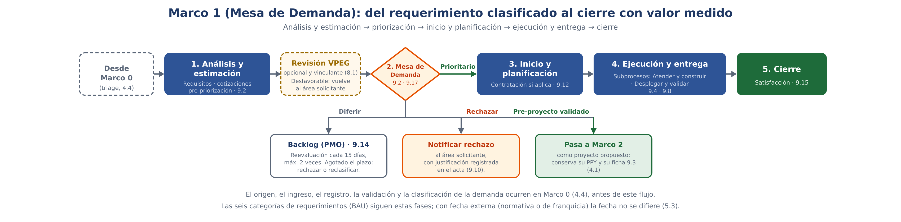

# 5. Marco metodológico 1: Gestión de requerimientos (BAU)

## 5.1 Objetivo

Gestionar de forma ordenada, medible y trazable la demanda que el triage de Marco 0 (4.4) clasificó en el grupo Requerimientos (BAU), en cualquiera de sus seis categorías, y los pre-proyectos. Esto incluye su análisis, priorización, planificación, ejecución y cierre con evidencia verificable. El pre-proyecto recorre aquí el análisis y la priorización; si la Mesa de Demanda lo valida, sigue en Marco 2 como proyecto propuesto (4.1). Los proyectos de entrada directa no pasan por Marco 1 (4.1).

## 5.2 Alcance

| **Incluye** | **No incluye / deriva a** |
|---|---|
| Requerimientos (BAU) en sus seis categorías: Cumplimiento normativo, Evolutivo, Solicitud de información, Mandatos de franquicias, POC / Estimaciones y Requerimientos IT4IT (con la historia de usuario como formato de escritura, 9.4), y el pre-proyecto hasta su validación por la Mesa de Demanda (4.1). | Proyectos: el proyecto propuesto y el proyecto de entrada directa se gestionan en Marco 2 (sección 6). Los incidentes tecnológicos se gestionan por el área de Medios Tecnológicos según el marco normativo interno del banco. |
| Análisis, priorización, planificación, contratación de proveedor cuando la demanda lo requiere, ejecución, cambios, liberación y cierre. La captura, el registro y la clasificación en grupo y categoría ocurren antes, en Marco 0 (4.4). | La selección y contratación de proveedores la conduce Administración (6.8.2). En Marco 1 ocurre en la fase 3, cuando la demanda lo requiere. |
| Evidencia, trazabilidad, KPIs, satisfacción del área solicitante y gestión de backlog. | |

## 5.3 Flujo operativo

**Este flujo recibe la demanda ya clasificada por Marco 0 (4.4):** el origen, el ingreso, el registro, la validación y la clasificación ya ocurrieron antes de llegar aquí. Tiene cinco fases: análisis y estimación, priorización, inicio y planificación, ejecución y entrega, y cierre.

*Figura 5. Flujo de demanda y entrega de valor en cinco fases (Marco 1), a partir de la demanda ya clasificada por Marco 0, con la revisión opcional de la VPEG y las salidas de la priorización (prioritario, diferir, rechazar y pre-proyecto validado). Adaptación basada en ITIL 4, COBIT 2019, CMMI V3.0 y TOGAF Standard 10.ª Edición.*

**La última columna indica el instrumento de la sección 9 que se usa en cada fase.** Así, parado en cualquier etapa, el equipo sabe exactamente qué plantilla abrir.

| **Fase** | **Actividad principal** | **Responsable** | **Evidencia** | **Instrumento** |
|---|---|---|---|---|
| 1\. Análisis y estimación | El área solicitante define los requisitos funcionales y gestiona los recursos de las áreas involucradas (Gestión de Procesos, Medios Tecnológicos, Seguridad Bancaria). Si se requiere proveedor, Administración genera las cotizaciones. El PM de demanda, con el analista de negocio, analiza el alcance y el beneficio, estima esfuerzo y costo y hace la pre-priorización con la hoja de priorización (9.2): la parte A, con el modelo de requerimientos, para los requerimientos; la parte B, con el modelo de proyectos, para los pre-proyectos. En paralelo, Seguridad Bancaria, Gestión de Procesos, Cumplimiento y Arquitectura emiten su observación cuando corresponde (ver abajo). | Área solicitante + PM de demanda (con el analista de negocio) + Administración si hay proveedor | Requerimiento o historia de usuario estimada, o ficha de pre-proyecto; pre-priorización | 9.4 · 9.3 (pre-proyecto) · 9.2 · 9.13 si aplica |
| 2\. Priorización | Si la VPEG decide revisar un ítem, se pronuncia antes de la sesión (8.1); si es desfavorable, el ítem vuelve al área solicitante. La Mesa de Demanda prioriza con el scoring y la matriz de capacidades y decide entre tres salidas: prioritario, diferir o rechazar. Un ítem prioritario sin capacidad inmediata se aprueba con inicio programado, no se difiere (7.3). Si el ítem se ejecuta con proveedor, aprueba su presupuesto. Los requerimientos con obligación externa con fecha siguen una regla propia (ver abajo). | VPEG (opcional) + Mesa de Demanda | Acta con la decisión | 9.2 · 9.17 · 9.10 |
| 3\. Inicio y planificación | El área ejecutora designa al responsable asignado; el PM de demanda lo registra en la ficha 9.1, le traspasa el seguimiento (9.0.1) y se fijan la fecha objetivo y el plan de entrega. Si hay que contratar proveedor, Administración lo selecciona y contrata (6.8.2). | Área ejecutora + PM de demanda + Administración si hay proveedor | Plan y fecha objetivo; contrato si aplica | 9.1 · 9.12 si aplica |
| 4\. Ejecución y entrega | El equipo asignado ejecuta dos subprocesos, «Atender y construir» y «Desplegar y validar», con las etapas de ejecución de 5.7, que incluyen el control del cambio productivo, el despliegue y el rollback. Antes de liberar, el dueño funcional da su conformidad sobre la UAT y se registra la decisión de pase a producción en el plan 9.8. | Equipo asignado (Gestión de Procesos, Medios Tecnológicos, Seguridad Bancaria y/o proveedor) | Entrega validada, conformidad del dueño funcional y cambio aprobado | 9.4 · 9.8 · 9.16 si aplica |
| 5\. Cierre | El área solicitante valida la satisfacción; Gestión de Procesos verifica la evidencia de aceptación y registra el cierre (5.7); se actualiza la documentación, se mide el KPI y se cierra. | Área solicitante + responsable asignado + Gestión de Procesos | Cierre y evidencia | 9.15 |

**¿Quién es el analista de negocio y cómo participa en la fase 1?** Es quien traduce la necesidad del dueño funcional en alcance y criterios de aceptación verificables. De Medios Tecnológicos participa el técnico de referencia del sistema, aplicación o plataforma donde vive el cambio. El analista de negocio pertenece a Gestión de Procesos, que lo asigna por línea o dominio de negocio; así es neutral frente al área que pide y frente a Medios Tecnológicos. Trabaja dentro del análisis que coordina el PM de demanda (8.2).

**Observación especializada en la fase 1:** durante el análisis, y en paralelo con él, Seguridad Bancaria, Gestión de Procesos, Cumplimiento y Arquitectura pueden emitir una observación especializada sobre la demanda. No es obligatoria para todo requerimiento, porque exigirla en una solicitud de información o en un ajuste menor solo agregaría espera sin valor. Se activa cuando la demanda cumple al menos una de estas condiciones: trata datos personales o información sensible de clientes; afecta un canal externo o de cara al cliente; modifica una integración con el core o la arquitectura de una plataforma; o responde a un requisito regulatorio. Con el mismo carácter consultivo se invita a Legal cuando el requerimiento lo ejecuta un proveedor bajo contrato o modifica ese contrato, exige compartir información con un tercero y por tanto un acuerdo de confidencialidad (6.8.2), o requiere interpretar una norma; y a Talento Humano cuando el cambio afecta funciones, cargos, perfiles o necesidades de capacitación del personal (6.7). Si además se tratan datos personales de colaboradores, se aplica la evaluación 9.13 como se indica abajo. Fuera de esos casos, cualquiera de estas áreas puede solicitar participar por iniciativa propia (6.7), pero el análisis no se detiene esperándola. La observación es consultiva: se registra en la ficha (9.1) y la Mesa de Demanda decide con ella a la vista.

**Cuando el disparador son los datos personales:** si la condición que activa la observación es el tratamiento de datos personales o información sensible de clientes, además de la observación se completa la evaluación de impacto en datos y privacidad (9.13), con el criterio de activación que esa ficha define: solo si la demanda introduce un tratamiento nuevo, cambia su finalidad, incorpora datos sensibles o perfilamiento, o abre transferencia a terceros o fuera del país. Si la demanda opera sobre un tratamiento ya evaluado sin alterarlo, basta referenciar la evaluación vigente en la ficha 9.1. La obligación nace del tratamiento, no del marco por el que se tramita la demanda: por eso 9.13 no es un instrumento exclusivo de proyecto. La Mesa de Demanda resuelve con la evaluación a la vista, sin elevarla a otra instancia: la demanda permanece en Marco 1, porque un hallazgo de privacidad no la reclasifica. En los supuestos de mayor exposición que 9.13 enumera, la Mesa de Demanda no puede aprobar sin el pronunciamiento favorable del oficial de protección de datos; si este observa, la demanda regresa a esta misma fase 1 para subsanar antes de proseguir.

**Cuando atender la demanda exige tocar la cartera de proyectos:** a veces un requerimiento solo puede atenderse liberando equipos que están comprometidos en proyectos ya aprobados. La Mesa de Demanda no puede resolver eso: pausar o reprogramar un proyecto en ejecución es un cambio mayor (6.6.1) y su decisión corresponde siempre a la Comisión de proyectos (8.1). Lo que la Mesa de Demanda hace es elevar el caso a la Comisión de proyectos como conflicto de capacidad, con el requerimiento ya registrado y puntuado (9.2), para que se compare con la cartera vigente con el mecanismo de 7.5. La comparación por puntaje es el mecanismo previsto para resolver disputas por una misma capacidad: no se negocia entre áreas ni se decide por antigüedad del proyecto.

**Lo que no corresponde pedirle al área solicitante.** No se le puede pedir que nomine qué proyectos de otras áreas deberían pausarse para atender su necesidad. No controla esos recursos, no responde por esos beneficios y no tiene los elementos para sopesar el daño de detenerlos; además, la decisión no es suya ni de la Mesa de Demanda. Trasladarle esa pregunta convierte una decisión de cartera en una negociación entre áreas y deja al área solicitante en una posición que el marco no le asigna. Si la demanda es tan relevante que justifica detener inversiones aprobadas, entonces cumple los criterios de conversión de 5.5 y el camino es elevarla como pre-proyecto, no pedir renuncias ajenas.

**Quién da la conformidad.** No se recaba área por área. El quórum de la Comisión de proyectos ya exige la presencia del sponsor del proyecto en cuestión (8.1), y cada sponsor es dueño de los beneficios de su proyecto (8.3): los afectados están en la sesión por diseño, exponen y son escuchados antes de que se decida. El marco no establece una conformidad previa del área afectada porque equivaldría a darle a cada sponsor un veto sobre la repriorización del portafolio, y ninguna cartera se repriorizaría nunca. La decisión es de la instancia colegiada y queda en el acta (9.10).

**Revisión de la VPEG antes de la sesión.** Si la VPEG decide revisar un ítem pre-priorizado (8.1) y se pronuncia en contra, el ítem no llega a la Mesa de Demanda: vuelve al área solicitante con la justificación. Si no se pronuncia, el ítem sigue a la sesión.

**Plazo hasta la decisión.** Un requerimiento llega a la sesión de la Mesa de Demanda en un máximo de 10 días hábiles desde su clasificación, y un pre-proyecto en un máximo de 20. Si el requerimiento no completó el análisis, entra a la sesión con la información disponible; si es un pre-proyecto, la Mesa de Demanda decide entre dar más plazo una sola vez, no mayor que el plazo original del tramo, o rechazarlo (11.3).

**Las tres salidas de la priorización:** la Mesa de Demanda resuelve cada demanda priorizada en una de tres formas.

- **Prioritario:** pasa a la fase 3 (Inicio y planificación). Si es un pre-proyecto, la Mesa de Demanda lo valida y pasa a Marco 2 como proyecto propuesto (4.1).

- **Diferir:** la demanda queda registrada en el backlog de requerimientos que administra la PMO, con su ID activo, su campo Estado en «Planificación» (9.1) y su reevaluación registrada en la bitácora 9.14. Se reevalúa cada 15 días calendario, hasta un máximo de dos reevaluaciones (30 días). Aplica también a los pre-proyectos. Si en ese plazo no logra priorizarse, la Mesa de Demanda debe decidir explícitamente entre rechazarla o reclasificarla; no puede quedar en espera indefinida (el silencio no es una opción, mismo principio de 6.7).

- **Rechazar:** con justificación registrada en el acta (9.10). La Mesa de Demanda, a través de la PMO, notifica el rechazo y su razón al área solicitante, que puede volver a registrar la demanda si las condiciones cambian.

**Por qué el flujo tiene esta estructura:** el análisis y la estimación se hacen en la misma fase para evitar traspasos. El inicio y la planificación se separan de la ejecución porque ahí se asigna el responsable, se fija la fecha objetivo y, si hace falta, se contrata al proveedor. La ejecución y el cambio productivo se concentran en los dos subprocesos de la fase 4, cuyas etapas define 5.7.

**Obligaciones externas con fecha.** Los requerimientos de Cumplimiento normativo y de Mandatos de franquicias que tienen una fecha fijada por el regulador, un organismo de control o una franquicia no se difieren ni se rechazan por su puntaje: la Mesa de Demanda asegura su cumplimiento y, si la capacidad no alcanza, escala el conflicto de capacidad sin diferir la obligación (7.3 · 7.5). El puntaje sirve para dimensionarlos y ubicarlos frente al resto de la carga.

### Cómo recorre el flujo cada categoría

Las seis categorías siguen las mismas cinco fases. La tabla indica solo lo que cambia en cada una; lo que no se menciona sigue la regla general de esta sección.

| **Categoría** | **Qué cambia en el flujo** |
|---|---|
| **Cumplimiento normativo** | Fase 1: se registra la norma, el informe o el hallazgo, y se activa la observación especializada (requisito regulatorio). Fase 2: si hay fecha externa, rige la regla de obligaciones externas. Forma parte de la cartera regulatoria consolidada (7.3). |
| **Evolutivo** | Sigue el flujo completo, normalmente en el backlog de producto con historias de usuario (9.4). Si el alcance crece, se aplica 5.4. |
| **Solicitud de información** | Fase 1 ligera: no requiere cotización ni observación especializada, salvo que trate datos personales (9.13). Fase 4: la entrega es la información, no un cambio en producción, de modo que «Desplegar y validar» se limita a validar la entrega con el área solicitante. |
| **Mandatos de franquicias** | Fase 1: se registra el mandato y su fecha límite. Fase 2: rige la regla de obligaciones externas; la decisión es siempre de la Mesa de Demanda. |
| **POC / Estimaciones** | Fase 1: se declara la hipótesis o la pregunta y un plazo máximo. Fase 3: la fecha fin no se prorroga sin decisión de la Mesa de Demanda. Fase 4: se ejecuta fuera de producción, sin plan de transición (9.8). Fase 5: se cierra con un informe de resultado (9.15) y su resultado se descarta o se registra como una demanda nueva vinculada. Método y plazos de referencia en 5.6. |
| **Requerimientos IT4IT** | El área solicitante y el dueño funcional son de Medios Tecnológicos. Compite por la misma capacidad de Medios Tecnológicos que el resto (9.17) y se prioriza en la misma sesión. Arquitectura emite observación cuando toca una plataforma. |

## 5.4 Control de cambios en los requerimientos

**Qué cubre esta sección.** Cuando una demanda ya priorizada cambia de alcance durante su ejecución, hace falta saber quién autoriza ese cambio y cómo queda registrado. Marco 2 resuelve lo equivalente en 6.6 con umbrales por magnitud; aquí se aplica el mismo principio de gobierno proporcional, con un gobierno mucho más liviano, acorde al tamaño de los requerimientos. No confundir con el control del cambio productivo (el despliegue a producción), que ocurre en la fase 4 y se documenta con el plan de transición (9.8).

| **Magnitud del cambio** | **Criterio orientativo** | **Autoriza** |
|---|---|---|
| **Menor** | No altera la fecha objetivo comprometida ni el esfuerzo estimado más allá de su holgura; precisa o corrige el alcance ya acordado. | Analista de negocio con el dueño funcional; se actualiza el requerimiento o la historia de usuario (9.4). |
| **Moderado** | Mueve la fecha objetivo, o incrementa el esfuerzo estimado por encima del rango acordado sin cambiar el grupo según el árbol de decisión (4.4). | Mesa de Demanda en su sesión semanal; se registra en el acta (9.10) y se actualiza la fecha vigente (10.2). |
| **Que cambia el grupo de la demanda** | Con el nuevo alcance, alguna pregunta determinante del árbol de decisión (2 a 4) pasa a «sí», o se suman tres o más de sus diez factores de complejidad, incluido el esfuerzo (4.4). | Se devuelve al triage de Marco 0 (4.4) para reclasificación. Si resulta pre-proyecto, sigue en Marco 1 hacia la validación de la Mesa de Demanda (5.5); si resulta proyecto de entrada directa, continúa en Marco 2 (4.1). |

**Cambio de categoría dentro del grupo.** Si el alcance cambia la categoría pero no el grupo (por ejemplo, un Evolutivo que resulta exigido por una norma), el PM de demanda actualiza la categoría en la ficha 9.1 y deja la razón; no hace falta volver al triage (4.3).

**Regla de proporcionalidad.** Un requerimiento no tiene sponsor ni presupuesto de inversión propio (el gasto con proveedor que aprueba la Mesa de Demanda no la convierte en inversión; ver sección 4 y 8.1), de modo que un cambio de alcance no dispara instancias adicionales ni un acta de constitución: se resuelve en la instancia que ya la gobierna. Lo único innegociable es que el cambio quede registrado y que la demanda no crezca en silencio hasta convertirse de hecho en un proyecto sin haber pasado por el gobierno que le corresponde. Ese es el propósito de la tercera fila: el crecimiento del alcance es la vía por la que un requerimiento acotado termina consumiendo el esfuerzo de un proyecto sin haber sido evaluado como tal.

**Trazabilidad e identificador.** Todo cambio de magnitud moderada o que cambie el grupo de la demanda recibe un identificador propio, **CHG-DEM-AAAA-NNNN-NN** (ej. CHG-DEM-2026-0142-01), vinculado al ID de la demanda que lo origina, con la misma lógica del **CHG-PRY-AAAA-NNN-NN** de los proyectos (6.6). El sufijo final numera los cambios sucesivos sobre una misma demanda. Los cambios menores no requieren identificador: quedan reflejados en la actualización del propio requerimiento o historia de usuario (9.4). Si el cambio implica además un despliegue a producción, el ID de cambio del sistema ITSM se registra en el plan de transición (9.8) y se referencia cruzadamente, sin reemplazar al identificador del marco.

Cuando el cambio compite por capacidad ya comprometida en otro ítem de Marco 1 o de Marco 2, se resuelve como conflicto de capacidad (7.5), no como un cambio ordinario de esta tabla.

## 5.5 Pre-proyecto: validación en la Mesa de Demanda y paso a Marco 2

El pre-proyecto recorre las fases 1 y 2 de Marco 1 (5.3) como el resto de la demanda, con tres particularidades. Se documenta en la ficha de pre-proyecto y caso de negocio ligero (9.3). La Mesa de Demanda no lo prioriza para ejecutarlo, sino para validarlo. Y su salida no es la fase 3, sino Marco 2 (4.1).

### 5.5.1 Criterios de conversión

**La definición del pre-proyecto y las variables que determinan su evolución a proyecto (costo estimado, tiempo de ejecución, equipo y riesgo) se desarrollan en la sección 4.1.** Son las mismas señales que el árbol de decisión detecta en el triage (4.4); esta tabla las traduce en umbrales operativos para confirmarlas con el análisis.

**Paso 4 del árbol.** Los criterios de conversión confirman, en el paso 4 del árbol de decisión, lo que el triage detectó. Si el análisis no los confirma, la Mesa de Demanda reclasifica el pre-proyecto como requerimiento (5.5.3). No sirven para convertir un requerimiento en proyecto: si un requerimiento crece, vuelve al triage (5.4).

| **Criterio** | **Umbral recomendado para derivar a proyecto** |
|---|---|
| Presupuesto | Requiere una inversión con acta de constitución o una contratación nueva y específica. |
| Cronograma | Tiene fecha de inicio y fin, hitos y dependencias relevantes. |
| Equipo | Demanda la participación coordinada de varias áreas o de un proveedor no cubierto por un contrato vigente. |
| Riesgo | Impacta producción, datos sensibles, continuidad, regulación, ciberseguridad o experiencia crítica de cliente. |
| Sponsor | Necesita patrocinio de negocio para decisiones, adopción y beneficios. |
| Beneficio | Tiene beneficios medibles que justifican seguimiento formal. |

**Proveedor con contrato vigente.** Lo que convierte la demanda en proyecto es requerir una inversión con acta o una contratación nueva y específica. Los cambios que un proveedor atiende con cargo a un contrato vigente, que ya fija un monto para ese fin, no convierten la demanda en pre-proyecto ni en proyecto: siguen siendo requerimientos (BAU), y su presupuesto lo aprueba la Mesa de Demanda (8.1).

### 5.5.2 Qué valida la Mesa de Demanda

La Mesa de Demanda verifica cuatro cosas: que el pre-proyecto cumpla los criterios de 5.5.1, su puntaje de scoring (7.1), que haya capacidad para su levantamiento según la matriz de capacidades (9.17) y que tenga un sponsor identificado. La Mesa de Demanda no aprueba presupuesto ni constituye el proyecto: eso corresponde a la Comisión de proyectos (6.5.1). Antes de la sesión, la VPEG puede revisarlo (8.1).

### 5.5.3 Salidas

- **Validado:** pasa a Marco 2 como proyecto propuesto, con su identificador PPY, su categoría de proyecto y su ficha 9.3 (6.2).

- **Diferido:** queda en el backlog de requerimientos y se reevalúa cada 15 días, hasta un máximo de dos veces (5.3 · 9.14).

- **Reclasificado:** si no cumple los criterios de conversión pero su alcance cabe en una categoría de requerimiento (por ejemplo, Evolutivo), la Mesa de Demanda lo reclasifica como requerimiento y sigue en Marco 1 con su nueva categoría, sin que el área tenga que volver a registrarlo.

- **Rechazado:** se notifica al área solicitante, con su razón y con la justificación registrada en el acta (9.10). El área puede volver a registrar la necesidad si las condiciones cambian (por ejemplo, si crece el costo, el riesgo o el alcance hasta cruzar alguno de los umbrales de 5.5.1).

### 5.5.4 Continuidad documental

La ficha de pre-proyecto y caso de negocio ligero (9.3) no se descarta. El levantamiento del proyecto en Marco 2 (6.3) la completa (caso de negocio, CAPEX/OPEX y análisis financiero) sin rehacer los requisitos ni las cotizaciones. El acta de constitución (9.5) la referencia como antecedente y hereda su problema, su beneficio esperado y su estimación de costo y tiempo. Si la VPEG ya revisó el pre-proyecto, en Marco 2 solo vuelve a revisarlo ante un cambio material (8.1).

## 5.6 POC / Estimaciones: método

La categoría POC / Estimaciones reúne dos tipos de demanda que se parecen en la forma, pero no en el propósito. Esta sección define cómo se conduce cada una, sobre las mismas cinco fases de Marco 1 (5.3) y con los instrumentos que ya existen.

- **POC:** prueba una hipótesis de viabilidad técnica o de negocio con una muestra acotada. Responde «¿funciona?».

- **Estimación:** dimensiona el esfuerzo, el costo o el plazo de una necesidad con una base declarada (analogía con casos anteriores, descomposición o juicio experto) y entrega un rango, no un número único. Responde «¿cuánto costaría o tardaría?».

**Ciclo de la POC.** Cinco pasos, montados sobre las fases que ya existen.

| **Paso** | **Qué se hace** | **Fase de Marco 1** |
|---|---|---|
| **1. Plantear** | Se declaran la hipótesis, un criterio de éxito medible y definido antes de empezar, el alcance y sus exclusiones, los datos y el entorno, el plazo y el costo. Una POC sin criterio de éxito no se prioriza. | 1 |
| **2. Aprobar** | La Mesa de Demanda la prioriza con el modelo de requerimientos (7.1.1). El impacto se califica por el de la decisión que la POC permitirá tomar, no por un beneficio que todavía no se conoce. | 2 |
| **3. Ejecutar** | En un entorno aislado, sin integraciones productivas y con datos anonimizados, seudonimizados o sintéticos (6.9). Se deja registro de lo probado. | 3 y 4 |
| **4. Evaluar** | Se compara el resultado con el criterio de éxito, con el área solicitante, Medios Tecnológicos y Arquitectura; Seguridad Bancaria se suma si hay datos sensibles o confidenciales. | 4 |
| **5. Decidir** | Descartar; repetir una sola vez con la hipótesis ajustada, con nueva aprobación de la Mesa de Demanda; o convertir en demanda nueva por el triage (4.4), con el informe de resultado como insumo de la ficha 9.1 o 9.3. | 5 |

**Ciclo de la Estimación.** Sigue las mismas fases con menos pasos: se declara la pregunta y el nivel de precisión esperado, se estima con una base explícita y se entrega un rango con sus supuestos. Su resultado alimenta la ficha 9.1 o 9.3 de la demanda que estima, o el plan anual si para eso se pidió.

**Reglas de borde:**

- **Plazo de referencia:** hasta 6 semanas para una POC y hasta 2 semanas para una Estimación. Se puede prorrogar una sola vez, con decisión de la Mesa de Demanda (11.2).

- **Contratación:** una licencia de prueba sin costo, o un proveedor con contrato vigente, no cambia la categoría. Si la prueba exige una contratación nueva y específica, aplica la pregunta 2 del árbol de decisión (4.4) y no es POC.

- **Confidencialidad:** una POC con proveedor o con licencia de prueba requiere el acuerdo de confidencialidad firmado antes de empezar (6.8.2).

- **Sin pase a producción:** lo que se quiera implementar entra como demanda nueva, vinculada a la POC. Lo construido en la POC no se reutiliza en producción sin pasar por el ciclo normal de Marco 1 o Marco 2.

**Instrumentos.** La POC y la Estimación se plantean en el bloque «POC / Estimación» de la historia de usuario (9.4) y se cierran con el informe de resultado de la ficha de cierre (9.15). No requieren un instrumento propio.

## 5.7 Etapas de ejecución de los subprocesos (común a Marco 1 y Marco 2)

**Para qué sirve:** una vez que la demanda o el proyecto está priorizado o aprobado y tiene recursos asignados, su ejecución sigue cinco etapas comunes a los dos marcos. Así todas las iniciativas tecnológicas se ejecutan con la misma metodología, la trazabilidad es homogénea, se reducen los reprocesos y nada llega a producción sin haber sido definido, desarrollado, certificado y aceptado por el área solicitante.

| **Etapa** | **Qué se hace** | **Quién actúa** | **Evidencia** | **Criterio para avanzar** |
|---|---|---|---|---|
| **1. Levantamiento de definiciones** | Requerimientos funcionales y no funcionales, reglas de negocio, criterios de aceptación, dependencias, impactos operativos y consideraciones técnicas necesarias para construir. | Gestión de Procesos conduce, con el analista de negocio; el área solicitante y los usuarios impactados aportan y aprueban | Documento de definiciones (9.16) o, en un ajuste puntual, el núcleo de la historia de usuario (9.4) | Definiciones aprobadas por el dueño funcional. Sin ellas no se desarrolla |
| **2. Desarrollo** | Construcción, parametrización, configuración o adquisición de la solución, conforme a las definiciones aprobadas y a los estándares tecnológicos vigentes. | Medios Tecnológicos y el proveedor, si lo hay | Historia de usuario (9.4) en Marco 1; informe de estado (9.18) en Marco 2 | Solución lista para certificar |
| **3. Certificación** | Pruebas funcionales, técnicas, de seguridad y de procesos que validan que la solución cumple lo definido y no genera riesgos para la operación. | Gestión de Procesos, laboratorio QA, usuarios mediante la UAT y Seguridad Bancaria; Cumplimiento y Arquitectura cuando aplica (6.7) | Informe de certificación y evidencia de UAT en el plan de transición (9.8) | Ninguna observación crítica abierta; las demás, resueltas, mitigadas o aceptadas formalmente como riesgo residual (6.7) |
| **4. Implementación** | Liberación al ambiente productivo: despliegue, contingencia, monitoreo inicial y comunicación a las áreas involucradas. | Medios Tecnológicos | Plan de transición (9.8) con la decisión de pase a producción | Pase a producción aprobado y hypercare iniciado |
| **5. Cierre** | Validación formal de que la solución satisface lo definido, con las evidencias de aceptación y la documentación. | El área solicitante valida; Gestión de Procesos verifica la evidencia de aceptación y registra el cierre | Ficha de cierre (9.15) en Marco 1; acta de cierre (9.19) en Marco 2; evidencias en el expediente (9.0.4) | Ítem cerrado |

**Cómo se ubican las etapas en cada marco.** Las etapas 1 y 2 forman el primer subproceso y las etapas 3 y 4, el segundo. La etapa 5 no es un subproceso: corresponde a la fase de cierre que ya tiene cada marco. En Marco 2, la etapa 1 parte del resultado del Discovery (6.3.1): cierra sus pendientes sin reabrir el alcance acordado.

| **Etapa** | **Marco 1** | **Marco 2** |
|---|---|---|
| **1. Levantamiento de definiciones · 2. Desarrollo** | «Atender y construir» (fase 4, 5.3) | «Construir y asegurar calidad» (fase 4, 6.3) |
| **3. Certificación · 4. Implementación** | «Desplegar y validar» (fase 4, 5.3) | «Transición a producción» (fase 5, 6.3) |
| **5. Cierre** | Fase 5, cierre (9.15) | Fase 6, cierre y beneficios (9.19) |

**Aplicación proporcional:** la Solicitud de información y las POC / Estimaciones no pasan a producción: recorren solo las definiciones, en el núcleo de la historia de usuario (9.4), la ejecución y el cierre. En un ajuste puntual de bajo riesgo, las etapas se compactan: las definiciones caben en el núcleo de 9.4, la certificación se reduce a la UAT y al procedimiento estandarizado de Medios Tecnológicos, y la implementación sigue el llenado proporcional del plan 9.8.

**Observaciones críticas:** una observación crítica de la certificación impide pasar a la implementación hasta que se resuelva. Es la única excepción al carácter consultivo de la certificación (6.7) y coincide con la regla de 9.8: no se pasa a producción con defectos críticos abiertos. La criticidad la declara quien certifica, con su justificación en el informe.

