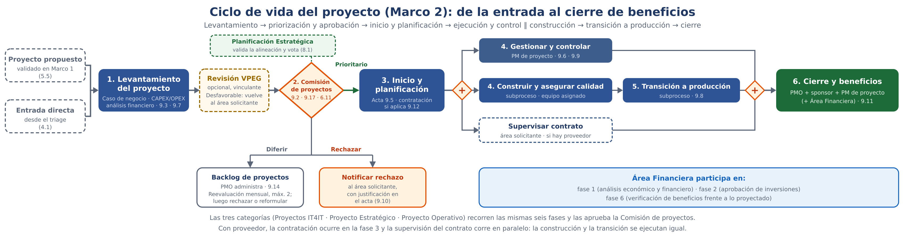
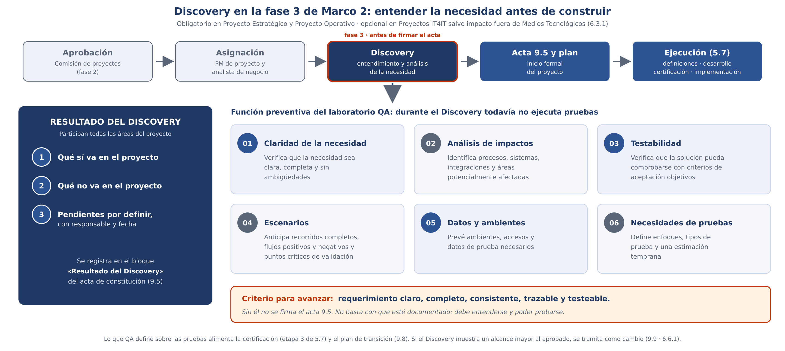

# 6. Marco metodológico 2: Gestión de proyectos

## 6.1 Objetivo

Asegurar que las inversiones tecnológicas del banco se seleccionen, aprueben, ejecuten y cierren con gobierno proporcional, alineación a los objetivos estratégicos, gestión de riesgos, control de costos y medición de beneficios. Aplica a las tres categorías de proyecto (sección 4): Proyectos IT4IT, Proyecto Estratégico y Proyecto Operativo.

## 6.2 Entrada a Marco 2

Un ítem entra a Marco 2 por una de dos vías: como proyecto propuesto, cuando la Mesa de Demanda validó el pre-proyecto (5.5), o como proyecto de entrada directa desde el triage, cuando ya tiene presupuesto asignado en el plan anual o responde a un mandato regulatorio o del Directorio (4.1). En ambos casos el ciclo empieza por su primera fase (6.3). Los criterios que convierten un pre-proyecto en proyecto están en 5.5.1. El proyecto llega con la categoría que le asignó la Mesa de triage (4.4), que la Comisión de proyectos puede corregir al priorizar (4.3).

**Las tres categorías en el ciclo.** Las tres recorren las mismas seis fases, las aprueba la misma instancia y en todas Planificación Estratégica valida la alineación (8.1). La categoría cambia el sponsor típico, el énfasis del caso de negocio y, en un caso, el nivel de participación de la alta dirección.

| **Categoría** | **Sponsor típico** | **Énfasis del caso de negocio** | **Gobierno adicional** |
|---|---|---|---|
| **Proyectos IT4IT** | CIO o su delegado para la capacidad tecnológica afectada. | Beneficio en capacidad interna: disponibilidad, productividad del equipo, reducción de deuda técnica o del costo de operación de Medios Tecnológicos. Arquitectura participa en la revisión técnica temprana (12.3). | Ninguno: compite por la misma capacidad e inversión que los proyectos de negocio (9.17). |
| **Proyecto Estratégico** | Alta dirección del área dueña del objetivo estratégico. | Contribución directa al objetivo estratégico nombrado (2.1.1) y beneficio de negocio cuantificado (9.7). | Participación de la alta dirección en la aprobación (6.5.1). |
| **Proyecto Operativo** | Alta dirección del área solicitante. | Necesidad específica con alcance definido; beneficio en eficiencia, costo, riesgo o servicio del área. | El que corresponda a su nivel de inversión (6.5.1). |

**Proyectos con obligación externa.** Un proyecto originado por una norma o un mandato no tiene categoría propia: se clasifica según su naturaleza, registra su origen normativo verificado por Cumplimiento y, si un tercero fija la fecha, lleva la marca de obligación externa (4.2). Solo su alcance normativo mínimo hereda la prioridad de 7.3. Si tiene fecha fijada por el regulador, rige la regla de 7.3 y su evaluación económica es la de la fila «Obligatorio regulatorio» de 6.5.1.

## 6.3 Ciclo de vida del proyecto tecnológico

**Este ciclo recibe, con su categoría, el proyecto propuesto que la Mesa de Demanda validó en Marco 1 (5.5),** o el proyecto de entrada directa desde el triage (4.1). En el proyecto propuesto, la primera fase completa la ficha 9.3 sin rehacer los requisitos ni las cotizaciones (5.5.4). El área solicitante pasa a ser sponsor o dueño funcional del proyecto. El PM de demanda sigue el proyecto hasta su aprobación y lo traspasa al PM de proyecto en la fase 3 (9.0.1). El ciclo tiene seis fases: levantamiento del proyecto, priorización y aprobación, inicio y planificación, ejecución y control, transición a producción, y cierre y beneficios.

*Figura 6. Ciclo de vida del proyecto tecnológico (Marco 2), con sus dos entradas (proyecto propuesto y entrada directa), la revisión opcional de la VPEG, la decisión de la Comisión de proyectos, la ejecución en paralelo y la participación del Área Financiera. Adaptación basada en PMBOK 8.ª Edición, COBIT 2019, CMMI V3.0 y TOGAF Standard 10.ª Edición.*

| **Fase** | **Propósito** | **Evidencia** | **Instr.** | **Lidera** |
|---|---|---|---|---|
| 1\. Levantamiento del proyecto | El área solicitante define los requisitos funcionales y el caso de negocio, aporta el volumen potencial de negocio y las variables de ahorro (9.7) y gestiona los recursos de las áreas involucradas. Si se requiere proveedor, Administración genera las cotizaciones. En el proyecto propuesto, estas actividades completan la ficha 9.3 en lugar de repetirse. El PM de demanda valida la documentación; Administración estima el CAPEX y el OPEX; el Área Financiera realiza el análisis económico y financiero, sin validar la viabilidad. | Ficha 9.3 completa + hoja de costo y retorno | 9.3 · 9.7 | Área solicitante + PM de demanda (+ Administración + Área Financiera) |
| 2\. Priorización y aprobación | El PM de demanda calcula el scoring y Planificación Estratégica valida la calificación de la alineación (7.1.2). Si la VPEG decide revisar el proyecto, se pronuncia antes de la sesión (8.1); si es desfavorable, el proyecto vuelve al área solicitante. El PM de demanda coordina la sesión de la Comisión de proyectos, donde el sponsor expone (6.11). La Comisión de proyectos revisa la capacidad con la matriz 9.17 y decide entre tres salidas: prioritario, diferir o rechazar. Un proyecto prioritario sin capacidad inmediata se aprueba con inicio programado, no se difiere (7.3). El Área Financiera participa en la aprobación de inversiones dentro de su nivel de autorización. | Presentación del sponsor + scoring + acta | 9.2 · 9.17 · 9.10 | PM de demanda + Planificación Estratégica + Comisión de proyectos (+ Área Financiera; VPEG opcional) |
| 3\. Inicio y planificación | La PMO nombra al PM de proyecto y al equipo. El PM de proyecto conduce el Discovery (6.3.1), firma el acta con el sponsor y planifica alcance, tiempo, costo, riesgos y transición. Incluye la revisión técnica temprana (12.3). Si hay que contratar proveedor, Administración lo selecciona y contrata. | Acta + plan + matriz de riesgos | 9.5 · 9.6 · 9.12 | PMO + PM de proyecto + sponsor (+ Administración) |
| 4\. Ejecución y control | Tres frentes en paralelo. El PM de proyecto gestiona y controla entregables, hitos, presupuesto, riesgos, cambios (6.6) y calidad, con Gestión de Procesos, Seguridad Bancaria y Cumplimiento acompañando (6.7). El equipo asignado ejecuta el subproceso «Construir y asegurar calidad»: levantamiento de definiciones y desarrollo (5.7). Si hay proveedor, el área solicitante supervisa el contrato en su dimensión funcional. | Informe de estado + matriz viva + solicitudes de cambio | 9.18 · 9.6 · 9.9 · 9.12 · 9.16 | PM de proyecto + equipo asignado (+ área solicitante supervisa el contrato, + Administración en lo legal y contractual) |
| 5\. Transición a producción | El equipo asignado ejecuta el subproceso «Transición a producción», con las etapas de certificación e implementación (5.7): pruebas, seguridad, continuidad, datos, capacitación, despliegue y rollback, con la certificación previa (6.7). Antes de liberar, el dueño funcional da su conformidad sobre la UAT y el PM de proyecto, con el sponsor, registra la decisión de pase a producción en el plan 9.8. | Plan de transición / cambio aprobado | 9.8 | Equipo asignado + PM de proyecto |
| 6\. Cierre y beneficios | Cuando terminan la gestión del PM de proyecto, la construcción, la transición y, si hubo proveedor, la supervisión del contrato, la PMO cierra el proyecto: contratos, lecciones aprendidas y medición de adopción y beneficios. El cierre se formaliza con el acta de cierre (9.19), que firman el sponsor, el PM de proyecto y la PMO, con la verificación de la evidencia de aceptación por Gestión de Procesos (5.7), y que se informa a la Comisión de proyectos. Antes de la firma, la PMO verifica que el expediente esté completo y lo archiva (9.0.4). El Área Financiera verifica con el PM de proyecto si los beneficios comprometidos se cumplieron frente a lo proyectado (9.7 · 9.11). | Seguimiento de beneficios + cierre de contrato | 9.11 · 9.12 · 9.19 | PMO + sponsor + PM de proyecto (+ Área Financiera + Administración) |

**Participación del Área Financiera en el ciclo de proyecto:** (1) Fase 1: realiza el análisis económico y financiero de la estimación de CAPEX y OPEX que prepara Administración y del caso de negocio, sin validar su viabilidad. (2) Fase 2: participa en la aprobación de inversiones dentro de su nivel de autorización según las políticas del banco. (3) Fase 6: verifica en conjunto con el PM de proyecto que los beneficios financieros comprometidos se hayan cumplido vs. el proyectado, antes de dar el cierre por válido.

**Revisión de la VPEG.** Si la VPEG decide revisar el proyecto (8.1) y se pronuncia en contra, el proyecto no llega a la Comisión de proyectos: vuelve al área solicitante. Si ya lo revisó como pre-proyecto en Marco 1, solo vuelve a revisarlo ante un cambio material.

**Plazo hasta la decisión.** El proyecto llega a la sesión de la Comisión de proyectos en un máximo de 30 días hábiles desde el inicio del levantamiento. Si no lo logra, la Comisión de proyectos decide entre dar más plazo una sola vez, no mayor que el plazo original del tramo, o rechazarlo (11.3).

**Las tres salidas de la priorización y aprobación:** la Comisión de proyectos resuelve cada proyecto propuesto o proyecto priorizado en una de tres formas.

- **Prioritario:** pasa a la fase 3 (Inicio y planificación).

- **Diferir:** queda registrado en el backlog de proyectos de la Comisión de proyectos, que administra operativamente la PMO, con su ID activo, su ficha vigente y su reevaluación registrada en la bitácora 9.14. Se reevalúa cada mes, hasta un máximo de dos reevaluaciones (dos meses). Si en ese plazo no logra priorizarse, la Comisión de proyectos debe decidir explícitamente entre rechazarlo o reformular su alcance; no puede quedar en espera indefinida (mismo principio de 5.3 y 6.7).

- **Rechazar:** con justificación registrada en el acta (9.10). La Comisión de proyectos, a través de la PMO, notifica el rechazo y su razón al área solicitante, que puede volver a registrar la necesidad si las condiciones cambian.

### 6.3.1 Discovery: entendimiento previo al inicio del proyecto

**Qué es:** la ceremonia en la que se entiende el negocio, el proceso y el problema antes de definir o construir la solución tecnológica. Busca asegurar que se resuelve la necesidad correcta y no solo que se implementa una herramienta.

**Cuándo ocurre:** en la fase 3, inicio y planificación, antes de firmar el acta de constitución. El orden es: la Comisión de proyectos aprueba; la PMO asigna al PM de proyecto y Gestión de Procesos al analista de negocio; se hace el Discovery; la revisión técnica temprana (12.3) toma su resultado como insumo; y se firman el acta (9.5) y el plan.

**A quién aplica:** es obligatorio en el Proyecto Estratégico y en el Proyecto Operativo. En los Proyectos IT4IT es opcional, a criterio del PM de proyecto, salvo que el proyecto afecte procesos o usuarios fuera de Medios Tecnológicos: en ese caso es obligatorio.

**Quién participa:** todas las áreas involucradas en el proyecto. El PM de proyecto convoca y conduce; el analista de negocio facilita; participan el sponsor, el dueño funcional, los usuarios clave, Medios Tecnológicos con Arquitectura, el laboratorio QA y Seguridad Bancaria; Cumplimiento, Riesgos, Legal y Talento Humano, cuando se activa su disparador (6.7); y el proveedor, si ya está contratado y con el acuerdo de confidencialidad firmado (6.8.2).

**Qué produce:** tres resultados, que se registran en el bloque «Resultado del Discovery» del acta de constitución (9.5):

- **Qué sí va en el proyecto.**

- **Qué no va en el proyecto.**

- **Pendientes por definir,** cada uno con responsable y fecha.

**Función preventiva del laboratorio QA:** durante el Discovery, QA todavía no ejecuta pruebas: previene defectos desde el inicio revisando seis puntos.

| **Punto** | **Qué hace el laboratorio QA** |
|---|---|
| **1. Claridad de la necesidad** | Verifica que la necesidad sea clara, completa y sin ambigüedades. |
| **2. Análisis de impactos** | Identifica procesos, sistemas, integraciones y áreas potencialmente afectadas. |
| **3. Testabilidad** | Verifica que la solución pueda comprobarse de forma objetiva con criterios de aceptación. |
| **4. Escenarios** | Anticipa recorridos completos, flujos positivos y negativos y puntos críticos de validación. |
| **5. Datos y ambientes** | Prevé los ambientes, accesos y datos de prueba necesarios. |
| **6. Necesidades de pruebas** | Define enfoques, tipos de prueba y una estimación temprana desde el inicio. |

**Criterio para avanzar:** el requerimiento debe quedar claro, completo, consistente, trazable y testeable. No basta con que esté documentado: debe entenderse y poder probarse. Sin este criterio cumplido no se firma el acta de constitución (9.5).

**Cómo se conecta con el resto del marco:** lo que va y lo que no va alimenta el alcance y las exclusiones del acta 9.5. Si el Discovery muestra un alcance mayor que el aprobado en la ficha 9.3, se tramita como cambio con la solicitud 9.9 y, según los umbrales de 6.6.1, decide la Comisión de proyectos. Los pendientes se cierran en la etapa 1 de ejecución (5.7), sin reabrir el alcance acordado. Lo que QA define sobre las pruebas alimenta la certificación (etapa 3 de 5.7) y el plan de transición (9.8).

*Figura 7. Discovery en la fase 3 de Marco 2: resultado del entendimiento de la necesidad y función preventiva del laboratorio QA, antes de firmar el acta de constitución. Adaptación del material del banco.*

## 6.4 Controles mínimos de proyecto bancario

| **Control** | **Qué debe contener** |
|---|---|
| Alcance | Baseline, exclusiones, criterios de aceptación, control de cambios. |
| Tiempo y costo | Cronograma con hitos, presupuesto (CAPEX/OPEX) y seguimiento de variaciones. La evaluación económica se desarrolla en 6.5. |
| Riesgo | Riesgos relevantes con mitigación, dueño y fecha (matriz 9.6). |
| Seguridad y datos | Datos sensibles, accesos, cifrado y pruebas; privacidad si trata datos personales (6.9). |
| Continuidad y operación | RTO/RPO, soporte, monitoreo y contingencia para el pase a producción. |
| Cumplimiento | Regulación aplicable, evidencias de auditoría y protección de datos personales. |
| Calidad y adopción | Pruebas (incluida la UAT, es decir, las pruebas de aceptación del usuario, en las que el área solicitante valida que la solución cumple sus requisitos antes del pase a producción), con la conformidad del dueño funcional y la decisión de pase a producción registradas en 9.8; capacitación, comunicación y soporte post-producción. |
| Proveedores | Si hay terceros: acuerdo de confidencialidad (NDA) firmado antes de compartir cualquier información del banco, incluso para cotizar o para una POC (6.8.2); contrato, SLA, riesgos de dependencia y cláusula de salida (6.8). |
| Dependencias | Proyectos de los que depende y para los que es prerrequisito, con su hito de enganche (6.10). |
| Beneficios | KPI base, meta, sponsor responsable del beneficio y fecha de medición. |
| Expediente | Expediente único del proyecto en el repositorio documental oficial, con su contenido mínimo, custodia, acceso y retención (9.0.4). |

## 6.5 Evaluación económica y financiera

Un proyecto bancario tiene que sostenerse en números. La regla es simple: toda inversión calcula su costo total simple, su retorno y su período de recuperación; el análisis con valor del dinero en el tiempo (VAN/TIR) queda reservado para los casos en que la Comisión de proyectos lo solicite expresamente.

### 6.5.1 Qué se exige según el nivel de inversión

| **Rango de inversión** | **Análisis exigido** | **Aprueba** |
|---|---|---|
| Bajo (hasta ~USD 10.000) | Estimación de costo y beneficio cualitativo, en la propia ficha 9.3. | Comisión de proyectos |
| Medio y alto (más de ~USD 10.000) | Hoja de costo y retorno (9.7): volumen potencial y variables de ahorro, CAPEX y OPEX detallados, TCO simple a 3 años, ROI y payback. | Comisión de proyectos |
| Muy alto o Proyecto Estratégico | Lo anterior y, solo si la Comisión de proyectos lo pide, VAN y TIR con la tasa de descuento del banco. | Comisión de proyectos con participación de la alta dirección |
| Obligatorio regulatorio | Costo de cumplir vs. costo/riesgo de no cumplir (multas, sanciones, exposición). | Comisión de proyectos con participación de la alta dirección |

## 6.6 Gestión de cambios y reprocesos

Ningún cambio se aplica «sobre la marcha» sin registrarse y evaluarse; todo cambio deja rastro y, según su magnitud, dispara un re-análisis.

### 6.6.1 Umbrales: quién aprueba según la magnitud

**Nota de nomenclatura:** la magnitud «Menor» de esta tabla clasifica cuánto pesa una modificación a un proyecto que ya está en ejecución en Marco 2, y solo determina quién la aprueba. No tiene relación con la clasificación de la demanda en grupo y categoría (sección 4). Un proyecto de inversión alta puede tener cambios de magnitud «Menor» sin dejar por ello de ser un proyecto.

| **Magnitud del cambio** | **Criterio orientativo** | **Aprueba** |
|---|---|---|
| Menor | No altera fecha de hito, presupuesto ni alcance comprometido. | PM de proyecto |
| Moderado | Afecta un hito, el presupuesto hasta cierto rango, o agrega alcance acotado. | Sponsor + PM de proyecto |
| Mayor | Cambia la fecha final, supera el rango de presupuesto, altera el alcance central o el caso de negocio. | Comisión de proyectos, con presentación del sponsor (6.11). |
| Que afecta contrato de proveedor | Modifica el alcance comprometido con un tercero. | Administración + Comisión de proyectos |

**Trazabilidad del cambio:** todo cambio se registra con la plantilla 9.9 y recibe un identificador propio (CHG-PRY-AAAA-NNN-NN) vinculado al proyecto. Su equivalente en los requerimientos de Marco 1 es el CHG-DEM-AAAA-NNNN-NN, con umbrales de autorización más livianos (5.4).

Cuando el cambio, o la aprobación de un nuevo proyecto, compite por capacidad ya comprometida en otro ítem de Marco 1 o de Marco 2, se resuelve como conflicto de capacidad (7.5).

## 6.7 Participación de las áreas especializadas: acompañan, no deciden

Seguridad Bancaria, Gestión de Procesos, Cumplimiento y Arquitectura acompañan al proyecto desde el caso de negocio hasta el cierre, y Riesgos lo hace cuando hay implicaciones de riesgo operativo, de negocio o regulatorio (8.2). Emiten concepto experto y levantan alertas, pero no aprueban, no vetan y no detienen el proyecto. Las decisiones las toman la Comisión de proyectos, el sponsor y el PM de proyecto.

**Áreas que acompañan por invitación:** Legal y Talento Humano acompañan, en Marco 1 y en Marco 2, solo cuando la demanda o el proyecto activa su disparador. Legal, cuando el trabajo lo ejecuta un proveedor bajo contrato o modifica ese contrato, cuando exige compartir información con un tercero y por tanto un acuerdo de confidencialidad (6.8.2), cuando hay propiedad intelectual en juego o cuando hace falta interpretar una norma. Talento Humano, cuando el cambio afecta funciones, cargos, perfiles o necesidades de capacitación del personal, o incorpora personal externo al equipo. Rigen para ellas las mismas reglas de esta sección: emiten concepto, no aprueban ni vetan. A diferencia de las áreas anteriores, no certifican antes del despliegue ni reportan capacidad en la matriz 9.17. Administración no figura aquí porque su papel no es consultivo sino operativo: cotiza, contrata y cierra los contratos con proveedores (6.8.2).

**Qué deben hacer (obligatorio):**

- **Emitir concepto** en la revisión técnica temprana (12.3) cuando el proyecto trata datos sensibles, modifica un proceso crítico, o tiene riesgo de continuidad o de cumplimiento regulatorio.

- **Participar en la ejecución y en la transición a producción** (fases 4 y 5 del ciclo de proyecto, 6.3): acompañan la ejecución y control, y la construcción y aseguramiento de calidad antes del pase a producción, con concepto experto, no con poder de veto.

- **Dejar constancia** de su concepto y de cualquier alerta en el acta de sesión (9.10) cuando participan como consultados.

- **Revisar los cambios** de magnitud moderada o mayor que afecten alcance de seguridad o de proceso (6.6), antes de que el sponsor, el PM de proyecto o la Comisión de proyectos decidan.

- **Confirmar en el cierre** (fase 6) si sus alertas fueron atendidas, mitigadas o formalmente aceptadas como riesgo residual por el sponsor.

**Qué pueden hacer (a discreción):**

- **Pedir información adicional** al dueño funcional o al PM de proyecto durante el levantamiento del proyecto (fase 1) para formar su concepto.

- **Proponer mitigaciones** o controles compensatorios sobre el alcance, sin que eso implique aprobar ni vetar el proyecto.

- **Participar en las pruebas de aceptación (UAT, 6.4)** cuando el riesgo del proyecto lo amerite, sin que su participación sea obligatoria salvo que la Comisión de proyectos lo determine.

- **Solicitar ser invitadas** a sesiones de la Mesa de triage, la Mesa de Demanda o la Comisión de proyectos (8.1) cuando el tema en agenda las afecta directamente.

**Qué pasa con sus alertas:** ninguna de estas áreas puede detener el proyecto por sí sola. Cuando levantan una alerta de riesgo alto (exposición de datos sensibles, incumplimiento regulatorio, deuda técnica crítica), la instancia que corresponda (8.1) debe pronunciarse explícitamente sobre cómo la gestiona (mitigar, aceptar el riesgo o suspender) y dejar la decisión y su justificación registradas en el acta (9.10). El silencio no es una opción: la alerta no puede quedar sin respuesta documentada.

**Certificación previa al despliegue:** antes de liberar a producción, Seguridad Bancaria, Gestión de Procesos, Cumplimiento y Arquitectura ejecutan sus certificaciones sobre la solución construida, junto con las pruebas del laboratorio QA y la UAT de los usuarios (etapa 3 de 5.7). Aplica tanto a los proyectos de este marco como a los requerimientos de Marco 1 que pasan a producción (5.3). Su resultado es *consultivo*: la certificación no bloquea el despliegue por sí sola ni otorga un veto, en coherencia con el principio de esta sección, con una sola excepción: una observación crítica abierta impide el pase a producción hasta que se resuelva (5.7 · 9.8). Lo que sí es obligatorio es su trazabilidad: el informe de certificación se emite por escrito, se adjunta al plan de transición (9.8) y **la PMO debe atenderlo** (recibirlo, registrarlo y verificar que cada observación quedó resuelta, mitigada o formalmente aceptada como riesgo residual por el sponsor, o por el dueño funcional en un requerimiento de Marco 1, antes del pase a producción). Si el informe contiene una alerta de riesgo alto, se aplica la regla del párrafo anterior: la instancia que corresponda debe pronunciarse y dejarlo en acta. Un despliegue que avanza con observaciones abiertas y sin aceptación explícita del sponsor, o del dueño funcional en Marco 1, es una desviación del marco, y la PMO la reporta como tal.

**Ver también:** la matriz RACI (8.4) confirma su papel como consultadas durante el análisis y la ejecución, e informadas en las actividades de cierre; y 12.3 detalla los frentes técnicos que revisan (arquitectura, seguridad y datos, continuidad, cumplimiento).

## 6.8 Modalidades de ejecución: células dedicadas y proveedores externos

### 6.8.1 Células dedicadas (squads)

Para proyectos excepcionales, el banco puede montar una célula dedicada: un equipo multidisciplinario de dedicación completa que trabaja con método ágil propio (sprints y backlog) de principio a fin. Es la excepción, no la regla.

### 6.8.2 Proveedores externos y rol de Administración

Una parte importante de los proyectos del banco puede ejecutarse con terceros. La regla bancaria es invariable: tercerizar una función no terceriza la responsabilidad.

**Administración es la única área con facultad de seleccionar y contratar proveedores.** El PM de proyecto y el área técnica definen los requerimientos; Administración conduce el proceso de selección y firma el contrato. Se activa desde la fase 1, con las cotizaciones y la estimación de CAPEX y OPEX, y lidera formalmente la selección y el contrato en la fase 3, en paralelo con la planificación técnica. En Marco 1 cumple el mismo papel cuando la demanda requiere proveedor (5.3).

**Acuerdo de confidencialidad antes de compartir información.** Ninguna información del banco se comparte con un proveedor o un tercero, ni para cotizar, ni para una POC, ni durante la selección, sin un acuerdo de confidencialidad (NDA) firmado. Lo gestiona Administración, con el formato vigente del banco, antes de solicitar cotizaciones, y queda registrado en la ficha de proveedor (9.12) aunque el proveedor no llegue a ser contratado. Rige en los dos marcos. El acuerdo de confidencialidad no reemplaza la cláusula de confidencialidad del contrato ni, si se comparten datos personales, el contrato de encargo de tratamiento que exige la LOPDP (9.13).

## 6.9 Gestión de datos y privacidad

En Ecuador la protección de datos personales se rige por la Ley Orgánica de Protección de Datos Personales (LOPDP); el marco se alinea con sus principios, sin sustituir la asesoría del oficial de protección de datos del banco. Aunque esta sección está redactada dentro de Marco 2, sus reglas rigen para toda la demanda TIC: la obligación nace del tratamiento de datos, no del vehículo por el que la demanda se tramita.

- **Clasificar antes de diseñar:** toda demanda declara qué tipo de datos maneja, cualquiera sea el marco por el que se tramite.

- **Privacidad desde el diseño:** cuando la demanda introduce o modifica un tratamiento de datos personales, se completa la evaluación de impacto en datos y privacidad (9.13). La regla no es exclusiva de los proyectos: en Marco 1 se aplica durante el análisis de la fase 1 (5.3), con el mismo criterio de activación y la misma excepción para tratamientos ya evaluados.

- **Observación pendiente detiene el avance:** en los supuestos de mayor exposición que enumera 9.13 (datos sensibles, perfilamiento o decisiones automatizadas, transferencia a terceros o fuera del país, o resultado «requiere rediseño»), ninguna instancia de gobierno puede aprobar el avance mientras exista una observación del oficial de protección de datos sin subsanar. La demanda o el proyecto regresa a la etapa de análisis, subsana y vuelve a la misma instancia. Rige por igual en Marco 1 y en Marco 2: la obligación nace de la ley, no del tamaño de la demanda.

- **Datos reales fuera de producción:** como regla, los datos personales reales no se usan en desarrollo ni pruebas; se usan datos anonimizados, seudonimizados o sintéticos.

## 6.10 Dependencias entre proyectos

Es habitual que proyectos no puedan salir a producción si otro no está listo, que compartan plataforma o que compitan por el mismo equipo. Esta sección define el mecanismo para controlarlo: declarar la dependencia, atarla a un hito verificable y propagar los cambios que la afecten. Casi nunca se depende de otro proyecto completo, sino de una pieza concreta suya: un servicio de integración, un ambiente, una parametrización. Por eso la dependencia se declara a nivel de hito.

- **Declaración obligatoria en el acta de constitución (9.5):** todo proyecto declara, en los dos sentidos, los hitos de otros proyectos o requerimientos que necesita y los hitos propios de los que dependen otros proyectos.

- **Hito de enganche:** cada dependencia se declara como «origen, hito y fecha comprometida → fase o hito del proyecto propio que lo necesita», por ejemplo «PRY-2026-031, servicio de consulta de saldos disponible en preproducción, 15 de marzo → inicio de pruebas integradas». El hito debe ser verificable. Funciona como criterio de salida de fase del proyecto dependiente y la PMO lo verifica antes de autorizar el avance. Depender de un proyecto completo es un caso particular: el hito es su pase a producción o su cierre. Solo se declaran los hitos de los que otro depende, no el cronograma completo: el marco no exige una red de cronogramas de toda la cartera.

- **Hito comprometido:** un hito del que depende otro proyecto no se mueve sin solicitud de cambio (9.9). El PM de proyecto que lo mueve avisa al PM de proyecto del proyecto dependiente y a la PMO. Si el impacto en el proyecto dependiente supera los umbrales de 6.6.1, decide la Comisión de proyectos.

- **Dependencia de un requerimiento de Marco 1:** el origen puede ser también una demanda de Marco 1, por ejemplo un evolutivo en el core, identificada con su ID (DEM). La demanda registra en su ficha 9.1 qué proyecto la necesita y para cuándo, y su responsable asignado avisa al PM de proyecto y a la PMO si la fecha se mueve. Si la fecha del requerimiento y la necesidad del proyecto no se pueden conciliar, el caso se trata como conflicto entre marcos y lo resuelve la Comisión de proyectos (7.5).

- **Vista única en la PMO:** la lista de proyectos activos que mantiene la PMO incluye una columna de estado (Planificación · En ejecución · En pruebas · Suspendido · Finalizado · Cancelado, ver 9.1), una de categoría (Proyectos IT4IT · Proyecto Estratégico · Proyecto Operativo, ver 9.0.3), la marca de obligación externa (4.2) y una de dependencias con su hito de enganche y semáforo: verde, el hito llega a tiempo; amarillo, el hito se movió pero todavía hay holgura; rojo, el hito queda después de la fecha en que se necesita. La PMO la actualiza con los informes de estado (9.18). La Comisión de proyectos la revisa en cada sesión y resuelve los conflictos.

## 6.11 Presentación del proyecto ante la Comisión de proyectos

**Por qué existe esta regla.** La ficha de pre-proyecto (9.3), la hoja de costo y retorno (9.7) y el scoring (9.2) contienen todo lo que la Comisión de proyectos necesita para decidir, pero leerlos en sesión no es viable y repartirlos sin exponerlos produce instancias que aprueban sin haber entendido. La presentación es el momento en que alguien responde por la inversión frente a quienes la autorizan.

**Quién expone: el sponsor.** No el PM de proyecto ni la PMO. Quien pide la inversión es quien la sustenta, porque es quien responderá por los beneficios (8.3) y quien tendrá que impulsar la adopción en su área. El PM de proyecto acompaña y responde el detalle de alcance, cronograma, costo y riesgo si la Comisión de proyectos lo requiere, pero no sustituye al sponsor en la exposición. Si el sponsor no puede asistir, el punto no se trata: el quórum de la Comisión de proyectos ya exige su presencia (8.1) y la sesión lo reprograma.

**Cuándo se exige.** En dos momentos, y solo en esos dos: la aprobación de un proyecto propuesto o de entrada directa (fase 2 de 6.3) y la aprobación de un cambio mayor sobre un proyecto en ejecución (6.6.1). No se exige para informes de estado de rutina, cierres, diferimientos ni reevaluaciones del backlog de proyectos, que se resuelven con los instrumentos y el acta.

**Contenido mínimo para aprobar un proyecto.** La presentación debe responder estas preguntas. No es un guion de láminas: es la lista de lo que la Comisión de proyectos no puede dejar de saber antes de votar.

| **Qué debe responder** | **De dónde sale** |
|---|---|
| Qué problema resuelve, a quién afecta y con qué evidencia se sostiene que existe | Ficha 9.3 |
| Qué pasa si no se hace, y qué alternativas se evaluaron | Ficha 9.3 · checklist 12.1 |
| Qué se va a hacer y, sobre todo, qué queda fuera del alcance | Ficha 9.3 |
| Cuánto cuesta, qué retorna y en qué plazo se recupera | Hoja 9.7 |
| Cuándo estaría listo y de qué otros proyectos depende | Ficha 9.3 · dependencias 6.10 |
| Qué riesgos principales tiene y cómo se mitigan | Matriz 9.6 o, si aún no existe, la ficha 9.3 |
| Qué puntaje obtuvo en el scoring y por qué | Hoja 9.2 |
| A qué se compromete el sponsor: beneficio, meta, fecha de medición y dueño | Hoja 9.7 · seguimiento 9.11 |

**Contenido mínimo para aprobar un cambio mayor.** Es una exposición distinta y más corta, porque el proyecto ya fue aprobado: qué cambió respecto de lo que la Comisión de proyectos autorizó, por qué cambió, cuál es el impacto en costo, plazo y alcance contrastando línea base contra situación vigente, qué alternativas se consideraron antes de pedir el cambio, y qué ocurre si el cambio no se aprueba. Todo ello se sustenta en la solicitud de control de cambios (9.9) y, si mueve la fecha final, en la marca de nueva línea base.

**La presentación no crea información nueva.** Sintetiza la que ya está en los instrumentos. Si un dato aparece en la presentación y no en la ficha que lo debía contener, la ficha está incompleta: se corrige antes de la sesión, no después. Esta regla evita que la presentación se convierta en un artefacto paralelo que compita con el caso de negocio.

**El formato lo define la PMO.** La PMO define, publica y mantiene la plantilla de presentación (diseño, número máximo de láminas, tiempo de exposición y antelación con que debe circular antes de la sesión), en ejercicio de la custodia metodológica que le asigna 12.4. La plantilla no forma parte de este documento y sus ajustes son un cambio menor del marco, que la PMO aplica e informa a la Comisión de proyectos. Lo que sí forma parte del marco, y solo cambia como cambio mayor, es el contenido mínimo definido arriba: la PMO puede cambiar cómo se ve la presentación, no qué debe responder.

**Verificación previa.** El PM de demanda, como secretario técnico de la Comisión de proyectos (8.1), verifica antes de la sesión que la presentación use el formato vigente y cubra el contenido mínimo. Si no lo cubre, el punto no entra en agenda y se reprograma, con aviso al sponsor indicando qué falta. El propósito no es formal: una instancia que recibe información incompleta decide mal o difiere, y ambas cosas cuestan más que reprogramar.

