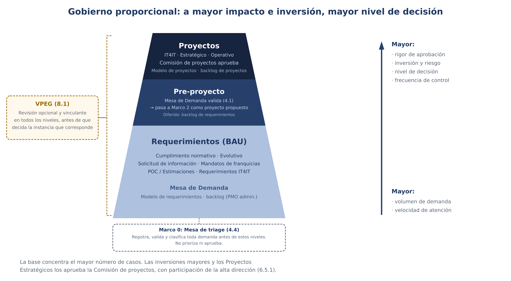

# 8. Gobierno: roles y comisiones

El gobierno se estructura en tres instancias, cada una con decisiones claras. La revisión técnica temprana (12.3) opera de forma consultiva y no requiere instancia propia. A ellas se suma la revisión de la Vicepresidencia Ejecutiva General (VPEG): no es una instancia del marco, sino una revisión ejecutiva, opcional y vinculante (8.1). La figura 7 resume ese gobierno proporcional.

*Figura 8. Gobierno proporcional por niveles, con las tres instancias de gobierno (Mesa de triage, Mesa de Demanda, Comisión de proyectos), los dos backlogs (de requerimientos y de proyectos) y la revisión opcional de la VPEG. Adaptación basada en COBIT 2019, PMBOK 8.ª Edición, CMMI V3.0 y TOGAF Standard 10.ª Edición.*

## 8.1 Modelo de gobierno

Las tres instancias cubren todo el ciclo: la Mesa de triage ordena la entrada y clasifica, la Mesa de Demanda prioriza los requerimientos (BAU) y valida los pre-proyectos, y la Comisión de proyectos aprueba, supervisa y cierra los proyectos. La plantilla 9.10 registra las actas.

### Mesa de triage

| **Aspecto** | **Detalle** |
|---|---|
| **Frecuencia** | Diaria o 2–3 veces por semana según volumen. |
| **Preside** | El PM de demanda o su delegado. |
| **Conformación** | PM de demanda · representante de Mesa de Servicio · un técnico de referencia de Medios Tecnológicos. Para demandas con impacto de proceso se invita a Gestión de Procesos; para las de seguridad o datos, a Seguridad Bancaria; para las de origen normativo, a Cumplimiento; para las que tienen componente contractual o legal, a Legal; para las que afectan al personal, a Talento Humano. |
| **Quórum mínimo** | PM de demanda + representante de Mesa de Servicio. |
| **Decisiones** | Registrar la demanda · validar que la ficha 9.1 sea clasificable · clasificar el grupo con el árbol de decisión y asignar la categoría (4.4) · registrar el origen normativo verificado por Cumplimiento y la marca de obligación externa (4.2) · asignar urgencia y enrutar · devolver al área solicitante lo que no sea clasificable. |
| **No decide** | Priorización, aprobación o rechazo de demanda, ni en Marco 1 ni en Marco 2 (eso corresponde a la Mesa de Demanda y a la Comisión de proyectos, respectivamente) · prioridad relativa entre pre-proyectos · aprobación de proyectos · presupuesto. |
| **Evidencia** | Sección de triage de la ficha 9.1; acta 9.10 solo si hay escalamiento. |

### Mesa de Demanda

**Alcance del nombre.** La Mesa de Demanda gobierna Marco 1, es decir, los requerimientos (BAU) y los pre-proyectos; no gobierna toda la demanda. Toda la demanda la recibe y la clasifica la Mesa de triage (Marco 0), y los proyectos de entrada directa no pasan por la Mesa de Demanda (4.1).

| **Aspecto** | **Detalle** |
|---|---|
| **Frecuencia** | Semanal como mínimo. En etapas de alto volumen puede sesionar dos veces por semana. |
| **Preside** | El responsable de la PMO o su delegado, que por lo general es el PM de demanda. Cuando el PM de demanda preside como delegado, conserva también la secretaría técnica. |
| **Conformación** | Responsable de la PMO o su delegado, por lo general el PM de demanda (preside) · PM de demanda (secretario técnico) · CIO o su delegado · líderes o representantes de las áreas solicitantes · Gestión de Procesos (voz consultiva) · Cumplimiento (voz consultiva) · Arquitectura (voz consultiva). |
| **Quórum mínimo** | Responsable de la PMO o su delegado + CIO o su delegado + al menos un líder o representante de un área solicitante con demanda en la agenda de la sesión. |
| **Decisiones** | Priorizar los requerimientos (BAU) de las seis categorías con el modelo de requerimientos (7.1.1) y la matriz de capacidades (9.17) · asegurar la fecha de los requerimientos con obligación externa, incluidos los Mandatos de franquicias, que decide siempre esta Mesa de Demanda (5.3 · 7.3) · aprobar el presupuesto de los requerimientos que se ejecutan con proveedor, dentro de los niveles de autorización del banco · validar pre-proyectos con el modelo de proyectos (7.1.2) y elevarlos a Marco 2 como proyectos propuestos (4.1), tras verificar los criterios de conversión (5.5), la capacidad para el levantamiento y que tengan un sponsor identificado · corregir la categoría de un ítem cuando corresponda (4.3) · resolver conflictos de capacidad entre requerimientos · diferir o rechazar requerimientos con justificación (mecánica y cadencia de reevaluación en 5.3) · resolver sobre la evaluación de impacto en datos y privacidad (9.13) de todos los requerimientos, cualquiera sea su resultado, dejando las condiciones registradas en el acta (9.10). La demanda no cambia de marco ni de instancia por un hallazgo de privacidad. |
| **No decide** | Aprobar presupuesto de pre-proyectos ni constituir proyectos: validar un pre-proyecto no es aprobar la inversión, que corresponde siempre a la Comisión de proyectos (6.5.1) · priorizar proyectos de Marco 2 · cambios mayores en proyectos en ejecución · pausar, reprogramar o repriorizar proyectos en ejecución, sean del área solicitante o de otra: el conflicto de capacidad se eleva a la Comisión de proyectos (5.3 · 7.5) · aprobar demanda contra el pronunciamiento del oficial de protección de datos en los supuestos de mayor exposición de 9.13 («requiere rediseño», datos sensibles, perfilamiento o transferencia a terceros o fuera del país): la observación se subsana en la fase 1 (5.3) antes de proseguir, o la demanda se rechaza · priorizar o validar contra un pronunciamiento desfavorable de la VPEG (8.1). |
| **Evidencia** | Acta de sesión con decisiones explícitas (9.10): aprobar · diferir · rechazar · fusionar · reclasificar · validar y elevar a Marco 2 (pre-proyectos) · elevar a la Comisión de proyectos (conflictos de capacidad). |

**Niveles de autorización de la Mesa de Demanda.** La Mesa de Demanda aprueba el presupuesto con proveedor de un requerimiento hasta (valor por definir) por requerimiento, con cargo a un contrato vigente que fije un monto para cambios de ese tipo. Lo que supere ese valor se eleva al nivel de autorización que corresponda según la política del banco (valor por definir). Cuando el banco fije los valores, se incorporan como cambio mayor del marco (12.4).

### Comisión de proyectos

| **Aspecto** | **Detalle** |
|---|---|
| **Frecuencia** | Quincenal o mensual. Se puede convocar extraordinariamente para cambios mayores urgentes. |
| **Preside** | El responsable de la PMO, o un delegado de la Vicepresidencia de Transformación Estratégica. |
| **Conformación** | Quien preside (responsable de la PMO o delegado de la Vicepresidencia de Transformación Estratégica) · CIO con poder de aprobación presupuestaria delegada · PM de demanda (secretario técnico) · sponsors de los proyectos en agenda · PM de proyecto de cada proyecto en revisión, asignados por la PMO · Gestión de Procesos (voz consultiva) · Seguridad Bancaria (voz consultiva) · Cumplimiento (voz consultiva) · Área Financiera (cuando en agenda haya proyectos con análisis de inversión o verificación de beneficios) · Planificación Estratégica (miembro con voz y voto; valida la alineación estratégica de cada proyecto). Para inversiones muy altas o Proyectos Estratégicos se incorpora la alta dirección del banco (6.5.1). |
| **Quórum mínimo** | Quien preside + CIO + sponsor del proyecto en cuestión + PMO. Si preside un delegado de la Vicepresidencia de Transformación Estratégica, la PMO, representada por su responsable o su delegado, debe estar presente para que la Comisión de proyectos sesione, porque custodia la metodología y los modelos de priorización (8.3). |
| **Decisiones** | Aprobar los proyectos propuestos que validó la Mesa de Demanda y los proyectos de entrada directa (4.1), con acta 9.5 · revisar estado e hitos de proyectos activos con sus informes de estado (9.18) · desbloquear riesgos y dependencias entre proyectos (6.10) · aprobar cambios mayores de alcance, costo o cronograma (6.6) · autorizar cancelaciones y cierres anticipados (9.10), tomar conocimiento de los cierres con su acta (9.19) y validar la medición de beneficios · priorizar, diferir o rechazar proyectos propuestos y proyectos con justificación, con el modelo de proyectos (7.1.2; mecánica y cadencia de reevaluación en 6.3) · corregir la categoría de un proyecto cuando corresponda (4.3) · pausar o cancelar proyectos · resolver los conflictos de capacidad entre la cartera y los requerimientos, ya sea que se los eleve la Mesa de Demanda cuando un requerimiento solo pueda atenderse tocando la cartera (5.3), o que se originen en un cruce de marco (7.5), comparando por el núcleo común (7.1.3) y con los sponsors afectados presentes · recibir en cada sesión la cartera regulatoria consolidada (7.3). |
| **No decide** | Detalles operativos de ejecución (responsabilidad del PM de proyecto) · clasificación y priorización de requerimientos (BAU) · aprobar un proyecto contra el pronunciamiento del oficial de protección de datos en los supuestos de mayor exposición de 9.13: mientras la observación no se subsane, el proyecto no prosigue · aprobar o priorizar contra un pronunciamiento desfavorable de la VPEG (8.1). |
| **Evidencia** | Acta de sesión con decisiones explícitas (9.10), a la que se anexa la presentación expuesta por el sponsor (6.11) en las aprobaciones de proyecto y de cambio mayor. La PMO mantiene la lista de proyectos activos con estado, dependencias y semáforo. |

La aprobación de presupuesto anual de inversiones TIC sigue el proceso presupuestario normal del banco; la Comisión de proyectos aprueba proyectos individuales dentro del presupuesto ya autorizado.

### Revisión de la Vicepresidencia Ejecutiva General (VPEG)

| **Aspecto** | **Detalle** |
|---|---|
| **Naturaleza** | Revisión ejecutiva, opcional y vinculante. No es una instancia de gobierno del marco ni un área que acompaña: es la autoridad ejecutiva del banco y decide, a su criterio, qué demanda revisa. Junto con el pronunciamiento del oficial de protección de datos (9.13), es una de las dos excepciones declaradas al principio «la instancia de gobierno decide». |
| **Qué revisa** | Cualquier ítem pre-priorizado de Marco 1 o de Marco 2, antes de que decidan la Mesa de Demanda o la Comisión de proyectos. |
| **Cómo se activa** | Antes de cada sesión, la PMO pone a disposición de la VPEG la lista de ítems pre-priorizados con su puntaje. La VPEG puede pronunciarse sobre cualquiera de ellos. |
| **Plazo** | Hasta la sesión en que decide la instancia. Si la VPEG no se pronuncia, se entiende que decidió que el proceso siga su curso, y el ítem entra a la sesión. |
| **Resultado** | Favorable (sigue a la instancia) · Favorable con condiciones (las condiciones quedan en el acta y en la ficha del ítem) · Desfavorable. |
| **Si es desfavorable** | El ítem no entra a la Mesa de Demanda ni a la Comisión de proyectos: se devuelve al área solicitante con la justificación. Como en cualquier rechazo, el área puede volver a registrar la demanda si las condiciones cambian. |
| **Una sola revisión** | Si la VPEG revisó el pre-proyecto en Marco 1, en Marco 2 solo lo vuelve a revisar ante un cambio material de alcance, costo o plazo respecto de lo revisado. |
| **Presidencia** | La VPEG no preside ninguna instancia del marco. Solo valida, cuando ella lo decide, lo que va a la Mesa de Demanda o a la Comisión de proyectos. |
| **Evidencia** | Constancia en el acta de la instancia (9.10) y en la ficha del ítem. |

## 8.2 Responsabilidades por rol

| **Rol** | **Responsabilidad principal** | **Área (recomendada)** |
|---|---|---|
| Dueño funcional | Plantea la necesidad, valida el alcance y los criterios de aceptación funcionales, prioriza el backlog de producto que mantiene el analista de negocio (9.4), da la conformidad sobre la UAT antes del pase a producción (9.8) y opera o usa la solución entregada. En los requerimientos, que no tienen sponsor formal, también responde por el resultado funcional (8.2.1). | Área solicitante |
| Analista de negocio | Traduce la necesidad del dueño funcional en alcance y criterios de aceptación verificables (fase 1, dentro del análisis que coordina el PM de demanda); redacta la historia de usuario de todo requerimiento y mantiene y refina el backlog de producto, cuyo orden de prioridad define el dueño funcional (9.4); participa junto a la Mesa de Demanda en la priorización de Marco 1 (fase 2, 5.3); facilita el Discovery en Marco 2 (6.3.1) y apoya el levantamiento de definiciones (etapa 1 de 5.7). | Gestión de Procesos, asignado por línea o dominio de negocio |
| Mesa de Servicio | Punto de contacto de las áreas con Medios Tecnológicos: orienta al canal único (9.1) la demanda que corresponde a este marco y participa en la Mesa de triage (8.1). | Medios Tecnológicos |
| PM de demanda | Actúa en las tres instancias. Preside la Mesa de triage: registra, clasifica y enruta la demanda (4.4). Pre-prioriza con el modelo que corresponde, mantiene el backlog único y la lista de proyectos activos, administra los modelos de priorización por encargo de la PMO y es secretario técnico de la Mesa de Demanda y de la Comisión de proyectos (8.1). Por lo general preside la Mesa de Demanda como delegado del responsable de la PMO. Es el responsable de seguimiento de la demanda hasta que la recibe el responsable asignado o, en un proyecto, el PM de proyecto (9.0.1); en ese mismo tramo custodia el expediente (9.0.4). | PMO |
| PM de proyecto | Planifica, ejecuta y controla los proyectos de Marco 2 que la PMO le asigna; gestiona alcance, cronograma, costo, riesgos, cambios y calidad, y reporta con el informe de estado (9.18). Custodia el expediente del proyecto desde la fase 3 (9.0.4). La PMO puede asignar este rol y el de PM de demanda a la misma persona, pero son dos roles distintos y rige la regla de incompatibilidad de 8.3. | PMO |
| Gestión de Procesos | Acompaña con voz consultiva: asegura coherencia con procesos bancarios y evita automatizar el desorden (6.7). Aloja al equipo de analistas de negocio, que asigna por línea o dominio de negocio. En la ejecución conduce el levantamiento de definiciones (9.16), certifica, y en el cierre verifica la evidencia de aceptación y registra el cierre (5.7). | Gestión de Procesos |
| CIO | Máxima autoridad de Medios Tecnológicos. Integra la Comisión de proyectos con poder de aprobación presupuestaria delegada y la Mesa de Demanda, directamente o por medio de su delegado (8.1). Es el sponsor típico de los Proyectos IT4IT (6.2). | Medios Tecnológicos |
| Arquitectura | Emite concepto en la revisión técnica temprana sobre capacidades, datos, integración y obsolescencia (12.3). | Medios Tecnológicos |
| Laboratorio QA | Ejecuta las pruebas técnicas y funcionales de la certificación (etapa 3 de 5.7) y registra sus resultados en el informe de certificación del plan 9.8. Declara la criticidad de las observaciones que encuentra. En Marco 2 participa además en el Discovery con función preventiva, sin ejecutar pruebas (6.3.1). | Por confirmar; en principio Medios Tecnológicos |
| Seguridad Bancaria | Acompaña con voz consultiva: evalúa datos sensibles, accesos y resiliencia durante todo el ciclo (6.7). | Seguridad Bancaria |
| Riesgos | Acompaña con voz consultiva cuando la demanda o el proyecto tiene implicaciones de riesgo operativo, de negocio o regulatorio, y reporta su capacidad en la matriz 9.17. | Riesgos |
| Cumplimiento | Acompaña con voz consultiva, con el mismo papel que Gestión de Procesos y Seguridad Bancaria en los dos marcos: emite observación especializada cuando la demanda responde a un requisito normativo (5.3), acompaña al proyecto y certifica antes del despliegue (6.7). Su papel es solo consultivo: no forma parte del equipo asignado ni reporta capacidad en la matriz 9.17. | Cumplimiento |
| Legal | Acompaña por invitación, con voz consultiva, en los dos marcos: proveedor bajo contrato o cambio de ese contrato, acuerdo de confidencialidad, propiedad intelectual o interpretación de una norma (5.3 · 6.7). No certifica ni reporta capacidad en la matriz 9.17. | Legal |
| Talento Humano | Acompaña por invitación, con voz consultiva, en los dos marcos, cuando el cambio afecta funciones, cargos, perfiles o capacitación del personal, o incorpora personal externo (5.3 · 6.7). No certifica ni reporta capacidad en la matriz 9.17. Fuera del marco, ejecuta la contratación directa de personal según la política del banco cuando el dueño del área la decide (7.4). | Talento Humano |
| Planificación Estratégica | Miembro con voz y voto de la Comisión de proyectos. Valida la alineación de cada proyecto al objetivo estratégico del plan, que es el primer criterio del modelo de proyectos (7.1.2), y firma el caso de negocio como validación de esa alineación, no como aprobación de la inversión. | Planificación Estratégica |
| Área Financiera | Realiza el análisis económico y financiero de la estimación (fase 1), sin validar su viabilidad; participa en la aprobación de inversiones (fase 2); co-define con la PMO los indicadores económicos y de beneficio (sección 10) y las metas cuantitativas de cada proyecto; y verifica el cumplimiento de beneficios vs. proyectado al cierre (fase 6), donde firma la conformidad del costo ejecutado en el acta de cierre (9.19). Es un participante activo en proyectos con análisis de inversión formal. | Área Financiera |
| Administración | Única área con facultad de seleccionar y contratar proveedores. Genera las cotizaciones y estima el CAPEX y el OPEX en la fase 1, conduce la selección y formaliza el contrato en fase 3, supervisa el cumplimiento contractual durante la ejecución y cierra formalmente el contrato en fase 6 (6.8.2). | Administración |
| Sponsor | Patrocina la inversión, decide prioridades de su proyecto, expone el proyecto ante la Comisión de proyectos para su aprobación y la de sus cambios mayores (6.11), y responde por los beneficios (8.3). | Alta dirección del área solicitante |
| VPEG | Revisa a su criterio, antes de que decida la Mesa de Demanda o la Comisión de proyectos, los ítems pre-priorizados; su pronunciamiento es vinculante (8.1). | Vicepresidencia Ejecutiva General |
| Instancias de gobierno | Priorizan, aprueban, validan, difieren, rechazan, fusionan o cancelan según gobierno proporcional (8.1). | Gobierno TIC |

### 8.2.1 Dueño funcional y sponsor: por qué no son lo mismo

Es habitual confundir estos dos roles porque ambos «representan al negocio», pero responden por cosas distintas y operan en escalas distintas de demanda.

| **Aspecto** | **Dueño funcional** | **Sponsor** |
|---|---|---|
| **Qué tipo de demanda le corresponde** | Requerimientos (BAU) de Marco 1, en sus seis categorías: la mayoría del volumen diario. | Pre-proyectos desde su validación en la Mesa de Demanda, y proyectos: la demanda que requiere presupuesto formal y acta. |
| **Autoridad sobre presupuesto** | Ninguna. No aprueba ni gestiona presupuesto de proyecto. | Total sobre su proyecto: asegura los recursos y autoriza decisiones que exceden al PM de proyecto. |
| **Ante quién responde** | Ante su propio jefe de área, por el resultado funcional de lo que pidió. | Ante la Comisión de proyectos y la alta dirección, por el valor del proyecto. |
| **Permanencia del rol** | Puede repetirse en muchas solicitudes pequeñas; no requiere designación formal. | Se designa formalmente por proyecto (acta 9.5); sin sponsor identificado, el proyecto no debería aprobarse. |
| **Ejemplo** | El analista de cobranzas que pide un ajuste en un reporte y valida que el campo nuevo es correcto. | El gerente de Cobranzas que patrocina el proyecto de optimización de cobranzas, asegura el presupuesto y responde por la reducción de mora. |

**Regla práctica:** si la demanda tiene acta de constitución (9.5), tiene sponsor. Si no la tiene, quien la sostiene es un dueño funcional. Un pre-proyecto necesita un sponsor identificado para que la Mesa de Demanda lo valide (4.1); su designación formal ocurre en el acta de constitución (9.5), cuando la Comisión de proyectos aprueba el proyecto.

## 8.3 Sponsor, PM de demanda, PM de proyecto y PMO

Estos roles son el eje del gobierno de la demanda y de los proyectos: el sponsor responde por el «porqué» y el «para qué» de un proyecto específico; el PM de demanda, por «qué se atiende» en Marco 0 y Marco 1; el PM de proyecto, por el «cómo y cuándo» de cada proyecto que se le asigna en Marco 2; y la PMO cuida «cómo se hacen todos los proyectos y toda la demanda», sin ejecutar ninguno de los dos directamente. La PMO puede asignar el rol de PM de demanda y el de PM de proyecto a la misma persona; aun así, son dos roles distintos y el marco los nombra siempre por separado.

**Regla de incompatibilidad.** Una misma persona no puede actuar como PM de demanda en los puntos de agenda de un proyecto que ella misma dirige como PM de proyecto: no pre-prioriza ese proyecto, no verifica su presentación (6.11) ni levanta el acta de esa decisión (9.10). En esos puntos, la PMO designa a otro PM de demanda o a un delegado, y el acta deja constancia de la sustitución. Así nadie prepara la decisión sobre su propio proyecto.

| **Aspecto** | **Sponsor** | **PM de demanda** | **PM de proyecto** | **PMO** |
|---|---|---|---|---|
| Qué es | Una persona: el ejecutivo que patrocina un proyecto específico y responde por su valor de negocio. | Un rol de la PMO que gestiona la demanda en Marco 0 y Marco 1 y actúa como secretario técnico de las instancias. | Un rol de la PMO que planifica, ejecuta y controla los proyectos de Marco 2 que se le asignan. | Un área permanente: la oficina que define y custodia la metodología, asigna al PM de demanda y a los PM de proyecto y consolida el reporte agregado. |
| Funciones principales | Asegura presupuesto y recursos; firma el acta de cierre (9.19); expone el proyecto y sus cambios mayores ante la Comisión de proyectos (6.11); toma las decisiones que exceden al PM de proyecto; remueve obstáculos; es dueño de los beneficios; impulsa la adopción en el negocio. | Preside la Mesa de triage; clasifica, enruta y pre-prioriza la demanda; mantiene el backlog único y administra los modelos de priorización; verifica la agenda y levanta las actas de la Mesa de Demanda y de la Comisión de proyectos (9.10). | Define y mantiene el plan; prepara el acta de cierre (9.19); gestiona alcance, cronograma, costo, riesgos, cambios y calidad; coordina al equipo; reporta el estado con el informe 9.18; escala al sponsor lo que no puede resolver. | Define y custodia la metodología, las plantillas y los modelos de priorización; asigna al PM de demanda y a los PM de proyecto; consolida el reporte agregado (sección 10); define la estructura y los permisos del repositorio de expedientes y archiva al cierre (9.0.4); vela por la disciplina y la consistencia entre PM de proyecto. |
| Área a la que pertenece | Alta dirección del área solicitante dueña del proceso o capacidad. No pertenece a Medios Tecnológicos. | PMO. | PMO; reporta funcionalmente a la PMO, y operativamente al sponsor durante la ejecución de un proyecto. | Vicepresidencia de Transformación Estratégica. No pertenece a Medios Tecnológicos. |

## 8.4 RACI

**Analista de negocio:** es responsable (R), junto al dueño funcional, de traducir la necesidad en alcance y criterios de aceptación verificables durante el análisis y la estimación, dentro del trabajo que coordina el PM de demanda (fase 1, 5.3), y participa en la priorización de Marco 1 (fase 2, 5.3). No participa en la validación de pre-proyectos ni en la priorización o aprobación de proyectos, que corresponden a la Mesa de Demanda y a la Comisión de proyectos. Depende de Gestión de Procesos, no del área solicitante ni de Medios Tecnológicos, para ser neutral entre quien pide y quien construye. En Marco 2 es responsable (R) de facilitar el Discovery (6.3.1).

**Gestión de Procesos, Medios Tecnológicos y Seguridad Bancaria:** son consultados (C) en el análisis, la priorización y la gestión del proyecto, y responsables (R) de la ejecución como parte del equipo asignado: los subprocesos de construcción y despliegue en Marco 1 y de construcción y aseguramiento de calidad en Marco 2. Junto con Riesgos, reportan su capacidad en la matriz 9.17 (R). Seguridad Bancaria tiene además una responsabilidad específica: completa la evaluación de impacto en datos y privacidad (9.13) junto al oficial de protección de datos, en ambos marcos. Gestión de Procesos es además responsable (R) de verificar la evidencia de aceptación y registrar el cierre en los dos marcos (5.7). Esas responsabilidades no las convierten en instancia de decisión: quien resuelve es la Mesa de Demanda o la Comisión de proyectos, según el caso.

**Cumplimiento:** verifica el origen normativo que declara el área solicitante en el triage (4.2) y es consultado (C) en el análisis, la priorización y la gestión del proyecto en los dos marcos, con el mismo papel consultivo que Gestión de Procesos y Seguridad Bancaria. A diferencia de ellos, no forma parte del equipo asignado ni reporta capacidad en la matriz 9.17.

**Riesgos:** es consultado (C) en el análisis, la priorización y la gestión del proyecto cuando hay implicaciones de riesgo operativo, de negocio o regulatorio, y responsable (R) de reportar su capacidad en la matriz 9.17.

**Administración:** es responsable de generar las cotizaciones, de estimar el CAPEX y el OPEX de los proyectos y de seleccionar y contratar proveedores cuando la demanda o el proyecto lo requieren, en Marco 1 y en Marco 2.

**Área Financiera:** es responsable del análisis económico y financiero (fase 1 de 6.3), sin validar su viabilidad, que corresponde al dueño funcional o sponsor. Co-define con la PMO los indicadores y metas de beneficio, y verifica los beneficios frente a lo proyectado al cierre (R), con el sponsor como responsable último (A). En la aprobación de inversiones participa dentro de su nivel de autorización (C); la aprobación es de la Comisión de proyectos.

**VPEG:** es responsable y accountable (A/R) de su revisión opcional, que es vinculante (8.1). No participa en el resto de las actividades.

**Planificación Estratégica:** es miembro con voz y voto de la Comisión de proyectos (8.1). Es responsable y accountable (A/R) de validar la alineación estratégica de cada proyecto, primer criterio del modelo de proyectos (7.1.2), y consultada (C) en su priorización y aprobación, que sigue siendo de la Comisión de proyectos (A). Verifica que los proyectos priorizados y aprobados permanezcan alineados a los objetivos estratégicos del plan del banco (2.1.1).

**Regla de lectura:** cada actividad tiene un único responsable último (A). La matriz se presenta en dos partes, una por instancia de priorización: 8.4.1 para los requerimientos (Marco 0 y Marco 1, incluido el pre-proyecto) y 8.4.2 para los proyectos (Marco 2). Las actividades compartidas (evaluación de privacidad, matriz de capacidades, revisión de la VPEG, contratación de proveedor y conflicto entre un requerimiento y un proyecto) aparecen en las dos con la misma asignación. Las filas siguen el orden de los flujos de 4.4, 5.3, 5.5 y 6.3. Abreviaturas de columnas: Área solic. = Área solicitante · An. neg. = Analista de negocio · Mesa serv. = Mesa de Servicio · Proc. = Gestión de Procesos · MT + Arquit. = Medios Tecnológicos, incluida Arquitectura · SB = Seguridad Bancaria · Cumpl. = Cumplimiento · Ries. = Riesgos · T. Hum. = Talento Humano · Adm. = Administración · Finan. = Área Financiera · Comisión de proy. = Comisión de proyectos · Planif. Estrat. = Planificación Estratégica. En la columna PMO, la PMO actúa por medio del PM de demanda en 8.4.1; en 8.4.2, por medio del PM de demanda hasta la aprobación del proyecto y del PM de proyecto que asigna desde la fase 3 (9.0.1). El laboratorio QA no tiene columna propia: se incluye en la columna de Medios Tecnológicos, en las actividades de construcción, despliegue y transición. Legal y Talento Humano figuran como C\*: son consultados solo cuando se activa su disparador (5.3 · 6.7); en el resto de las actividades no participan.

### 8.4.1 RACI de requerimientos (Marco 0 y Marco 1)

<table style="width:100%;">
<colgroup>
<col style="width: 22%" />
<col style="width: 4%" />
<col style="width: 4%" />
<col style="width: 4%" />
<col style="width: 4%" />
<col style="width: 4%" />
<col style="width: 4%" />
<col style="width: 3%" />
<col style="width: 4%" />
<col style="width: 4%" />
<col style="width: 4%" />
<col style="width: 4%" />
<col style="width: 4%" />
<col style="width: 4%" />
<col style="width: 4%" />
<col style="width: 5%" />
<col style="width: 5%" />
<col style="width: 5%" />
</colgroup>
<thead>
<tr class="header">
<th><strong>Actividad</strong></th>
<th>
<strong>Área</strong>

<strong>solic.</strong>
</th>
<th>
<strong>An.</strong>

<strong>neg.</strong>
</th>
<th>
<strong>Mesa</strong>

<strong>serv.</strong>
</th>
<th><strong>PMO</strong></th>
<th><strong>Proc.</strong></th>
<th>
<strong>MT +</strong>

<strong>Arquit.</strong>
</th>
<th><strong>SB</strong></th>
<th><strong>Cumpl.</strong></th>
<th><strong>Ries.</strong></th>
<th><strong>Legal</strong></th>
<th>
<strong>T.</strong>

<strong>Hum.</strong>
</th>
<th><strong>Adm.</strong></th>
<th><strong>Finan.</strong></th>
<th><strong>VPEG</strong></th>
<th>
<strong>Mesa de</strong>

<strong>Demanda</strong>
</th>
<th>
<strong>Comisión</strong>

<strong>de proy.</strong>
</th>
<th>
<strong>Planif.</strong>

<strong>Estrat.</strong>
</th>
</tr>
</thead>
<tbody>
<tr class="odd">
<td><strong>Marco 0 · Triage (común)</strong></td>
<td></td>
<td></td>
<td></td>
<td></td>
<td></td>
<td></td>
<td></td>
<td></td>
<td></td>
<td></td>
<td></td>
<td></td>
<td></td>
<td></td>
<td></td>
<td></td>
<td></td>
</tr>
<tr class="even">
<td>Ingresar la necesidad (9.1 A)</td>
<td>A/R</td>
<td>–</td>
<td>–</td>
<td>I</td>
<td>–</td>
<td>–</td>
<td>–</td>
<td>–</td>
<td>–</td>
<td>–</td>
<td>–</td>
<td>–</td>
<td>–</td>
<td>–</td>
<td>–</td>
<td>–</td>
<td>–</td>
</tr>
<tr class="odd">
<td>Registrar, validar y clasificar (árbol, 4.4)</td>
<td>C</td>
<td>–</td>
<td>R</td>
<td>A/R</td>
<td>C</td>
<td>C</td>
<td>C</td>
<td>C</td>
<td>–</td>
<td>–</td>
<td>–</td>
<td>–</td>
<td>–</td>
<td>–</td>
<td>I</td>
<td>I</td>
<td>–</td>
</tr>
<tr class="even">
<td><strong>Marco 1 · Requerimientos (BAU)</strong></td>
<td></td>
<td></td>
<td></td>
<td></td>
<td></td>
<td></td>
<td></td>
<td></td>
<td></td>
<td></td>
<td></td>
<td></td>
<td></td>
<td></td>
<td></td>
<td></td>
<td></td>
</tr>
<tr class="odd">
<td>Definir requisitos y gestionar recursos</td>
<td>A/R</td>
<td>C</td>
<td>–</td>
<td>C</td>
<td>C</td>
<td>C</td>
<td>C</td>
<td>C</td>
<td>C</td>
<td>C*</td>
<td>C*</td>
<td>–</td>
<td>–</td>
<td>–</td>
<td>–</td>
<td>–</td>
<td>–</td>
</tr>
<tr class="even">
<td>Generar cotizaciones (si hay proveedor)</td>
<td>C</td>
<td>–</td>
<td>–</td>
<td>I</td>
<td>–</td>
<td>–</td>
<td>–</td>
<td>–</td>
<td>–</td>
<td>C*</td>
<td>–</td>
<td>A/R</td>
<td>–</td>
<td>–</td>
<td>–</td>
<td>–</td>
<td>–</td>
</tr>
<tr class="odd">
<td>Analizar, estimar y pre-priorizar (7.1.1)</td>
<td>C</td>
<td>R</td>
<td>C</td>
<td>A/R</td>
<td>C</td>
<td>C</td>
<td>C</td>
<td>C</td>
<td>C</td>
<td>C*</td>
<td>C*</td>
<td>C</td>
<td>–</td>
<td>–</td>
<td>I</td>
<td>–</td>
<td>–</td>
</tr>
<tr class="even">
<td>Evaluar datos y privacidad (9.13)</td>
<td>C</td>
<td>C</td>
<td>–</td>
<td>R</td>
<td>I</td>
<td>C</td>
<td>A/R</td>
<td>I</td>
<td>–</td>
<td>–</td>
<td>–</td>
<td>–</td>
<td>–</td>
<td>–</td>
<td>C</td>
<td>C</td>
<td>–</td>
</tr>
<tr class="odd">
<td>Reportar capacidad (matriz 9.17)</td>
<td>–</td>
<td>–</td>
<td>–</td>
<td>A</td>
<td>R</td>
<td>R</td>
<td>R</td>
<td>–</td>
<td>R</td>
<td>–</td>
<td>–</td>
<td>C</td>
<td>C</td>
<td>–</td>
<td>I</td>
<td>I</td>
<td>–</td>
</tr>
<tr class="even">
<td>Revisión de la VPEG (8.1)</td>
<td>I</td>
<td>–</td>
<td>–</td>
<td>R</td>
<td>–</td>
<td>–</td>
<td>–</td>
<td>–</td>
<td>–</td>
<td>–</td>
<td>–</td>
<td>–</td>
<td>–</td>
<td>A/R</td>
<td>I</td>
<td>–</td>
<td>–</td>
</tr>
<tr class="odd">
<td>Priorizar y aprobar presupuesto con proveedor</td>
<td>R</td>
<td>R</td>
<td>I</td>
<td>R</td>
<td>C</td>
<td>C</td>
<td>C</td>
<td>C</td>
<td>C</td>
<td>–</td>
<td>–</td>
<td>C</td>
<td>–</td>
<td>–</td>
<td>A</td>
<td>–</td>
<td>–</td>
</tr>
<tr class="even">
<td>Asegurar fecha de obligación externa (7.3)</td>
<td>R</td>
<td>–</td>
<td>–</td>
<td>R</td>
<td>–</td>
<td>C</td>
<td>C</td>
<td>–</td>
<td>C</td>
<td>–</td>
<td>–</td>
<td>–</td>
<td>–</td>
<td>–</td>
<td>A</td>
<td>I</td>
<td>–</td>
</tr>
<tr class="odd">
<td>Suspender: conflicto en Marco 1 (7.5)</td>
<td>C</td>
<td>C</td>
<td>–</td>
<td>–</td>
<td>–</td>
<td>–</td>
<td>–</td>
<td>–</td>
<td>–</td>
<td>–</td>
<td>–</td>
<td>–</td>
<td>–</td>
<td>–</td>
<td>A/R</td>
<td>–</td>
<td>–</td>
</tr>
<tr class="even">
<td>Suspender: conflicto entre marcos (7.5)</td>
<td>C</td>
<td>I</td>
<td>–</td>
<td>C</td>
<td>–</td>
<td>–</td>
<td>–</td>
<td>–</td>
<td>–</td>
<td>–</td>
<td>–</td>
<td>–</td>
<td>–</td>
<td>–</td>
<td>R</td>
<td>A</td>
<td>–</td>
</tr>
<tr class="odd">
<td>Iniciar y planificar la atención</td>
<td>C</td>
<td>–</td>
<td>–</td>
<td>A</td>
<td>C</td>
<td>R</td>
<td>C</td>
<td>C</td>
<td>–</td>
<td>–</td>
<td>C*</td>
<td>C</td>
<td>–</td>
<td>–</td>
<td>–</td>
<td>–</td>
<td>–</td>
</tr>
<tr class="even">
<td>Seleccionar y contratar proveedor</td>
<td>C</td>
<td>–</td>
<td>–</td>
<td>C</td>
<td>–</td>
<td>C</td>
<td>C</td>
<td>–</td>
<td>–</td>
<td>C*</td>
<td>–</td>
<td>A/R</td>
<td>–</td>
<td>–</td>
<td>I</td>
<td>I</td>
<td>–</td>
</tr>
<tr class="odd">
<td>Atender y construir · Desplegar y validar</td>
<td>C</td>
<td>C</td>
<td>I</td>
<td>A</td>
<td>R</td>
<td>R</td>
<td>R</td>
<td>C</td>
<td>C</td>
<td>–</td>
<td>C*</td>
<td>–</td>
<td>–</td>
<td>–</td>
<td>–</td>
<td>–</td>
<td>–</td>
</tr>
<tr class="even">
<td>Cerrar y validar satisfacción (9.15)</td>
<td>A/R</td>
<td>C</td>
<td>I</td>
<td>R</td>
<td>R</td>
<td>C</td>
<td>–</td>
<td>–</td>
<td>–</td>
<td>–</td>
<td>–</td>
<td>–</td>
<td>–</td>
<td>–</td>
<td>–</td>
<td>–</td>
<td>–</td>
</tr>
<tr class="odd">
<td><strong>Marco 1 · Pre-proyecto</strong></td>
<td></td>
<td></td>
<td></td>
<td></td>
<td></td>
<td></td>
<td></td>
<td></td>
<td></td>
<td></td>
<td></td>
<td></td>
<td></td>
<td></td>
<td></td>
<td></td>
<td></td>
</tr>
<tr class="even">
<td>Elaborar la ficha de pre-proyecto (9.3 A)</td>
<td>A/R</td>
<td>–</td>
<td>–</td>
<td>R</td>
<td>C</td>
<td>C</td>
<td>C</td>
<td>C</td>
<td>C</td>
<td>C*</td>
<td>C*</td>
<td>C</td>
<td>C</td>
<td>–</td>
<td>–</td>
<td>–</td>
<td>–</td>
</tr>
<tr class="odd">
<td>Validar el pre-proyecto y elevarlo a Marco 2</td>
<td>R</td>
<td>–</td>
<td>–</td>
<td>R</td>
<td>C</td>
<td>C</td>
<td>C</td>
<td>C</td>
<td>C</td>
<td>–</td>
<td>–</td>
<td>–</td>
<td>I</td>
<td>–</td>
<td>A</td>
<td>I</td>
<td>I</td>
</tr>
</tbody>
</table>

*Leyenda: R = Responsible (ejecuta) · A = Accountable (responde) · C = Consulted (consultado) · C\* = consultada solo si se activa su disparador (6.7) · I = Informed (informado) · – = No participa.*

### 8.4.2 RACI de proyectos (Marco 2)

<table style="width:100%;">
<colgroup>
<col style="width: 22%" />
<col style="width: 4%" />
<col style="width: 4%" />
<col style="width: 4%" />
<col style="width: 4%" />
<col style="width: 4%" />
<col style="width: 4%" />
<col style="width: 3%" />
<col style="width: 4%" />
<col style="width: 4%" />
<col style="width: 4%" />
<col style="width: 4%" />
<col style="width: 4%" />
<col style="width: 4%" />
<col style="width: 4%" />
<col style="width: 5%" />
<col style="width: 5%" />
<col style="width: 5%" />
</colgroup>
<thead>
<tr class="header">
<th><strong>Actividad</strong></th>
<th>
<strong>Área</strong>

<strong>solic.</strong>
</th>
<th>
<strong>An.</strong>

<strong>neg.</strong>
</th>
<th>
<strong>Mesa</strong>

<strong>serv.</strong>
</th>
<th><strong>PMO</strong></th>
<th><strong>Proc.</strong></th>
<th>
<strong>MT +</strong>

<strong>Arquit.</strong>
</th>
<th><strong>SB</strong></th>
<th><strong>Cumpl.</strong></th>
<th><strong>Ries.</strong></th>
<th><strong>Legal</strong></th>
<th>
<strong>T.</strong>

<strong>Hum.</strong>
</th>
<th><strong>Adm.</strong></th>
<th><strong>Finan.</strong></th>
<th><strong>VPEG</strong></th>
<th>
<strong>Mesa de</strong>

<strong>Demanda</strong>
</th>
<th>
<strong>Comisión</strong>

<strong>de proy.</strong>
</th>
<th>
<strong>Planif.</strong>

<strong>Estrat.</strong>
</th>
</tr>
</thead>
<tbody>
<tr class="odd">
<td><strong>Marco 2 · Entrada y aprobación</strong></td>
<td></td>
<td></td>
<td></td>
<td></td>
<td></td>
<td></td>
<td></td>
<td></td>
<td></td>
<td></td>
<td></td>
<td></td>
<td></td>
<td></td>
<td></td>
<td></td>
<td></td>
</tr>
<tr class="even">
<td>Levantar proyecto y caso de negocio</td>
<td>A/R</td>
<td>–</td>
<td>–</td>
<td>R</td>
<td>C</td>
<td>C</td>
<td>C</td>
<td>C</td>
<td>C</td>
<td>C*</td>
<td>C*</td>
<td>R</td>
<td>C</td>
<td>–</td>
<td>–</td>
<td>–</td>
<td>–</td>
</tr>
<tr class="odd">
<td>Estimar CAPEX y OPEX</td>
<td>C</td>
<td>–</td>
<td>–</td>
<td>C</td>
<td>–</td>
<td>C</td>
<td>–</td>
<td>–</td>
<td>–</td>
<td>–</td>
<td>–</td>
<td>A/R</td>
<td>C</td>
<td>–</td>
<td>–</td>
<td>–</td>
<td>–</td>
</tr>
<tr class="even">
<td>Análisis económico y financiero</td>
<td>C</td>
<td>–</td>
<td>–</td>
<td>C</td>
<td>–</td>
<td>–</td>
<td>–</td>
<td>–</td>
<td>–</td>
<td>–</td>
<td>–</td>
<td>C</td>
<td>A/R</td>
<td>–</td>
<td>–</td>
<td>–</td>
<td>–</td>
</tr>
<tr class="odd">
<td>Validar la viabilidad económica</td>
<td>A/R</td>
<td>–</td>
<td>–</td>
<td>C</td>
<td>–</td>
<td>–</td>
<td>–</td>
<td>–</td>
<td>–</td>
<td>–</td>
<td>–</td>
<td>–</td>
<td>C</td>
<td>–</td>
<td>–</td>
<td>C</td>
<td>–</td>
</tr>
<tr class="even">
<td>Definir indicadores y metas de beneficio</td>
<td>C</td>
<td>–</td>
<td>–</td>
<td>R</td>
<td>I</td>
<td>I</td>
<td>I</td>
<td>I</td>
<td>–</td>
<td>–</td>
<td>–</td>
<td>–</td>
<td>A/R</td>
<td>–</td>
<td>–</td>
<td>C</td>
<td>–</td>
</tr>
<tr class="odd">
<td>Evaluar datos y privacidad (9.13)</td>
<td>C</td>
<td>C</td>
<td>–</td>
<td>R</td>
<td>I</td>
<td>C</td>
<td>A/R</td>
<td>I</td>
<td>–</td>
<td>–</td>
<td>–</td>
<td>–</td>
<td>–</td>
<td>–</td>
<td>C</td>
<td>C</td>
<td>–</td>
</tr>
<tr class="even">
<td>Reportar capacidad (matriz 9.17)</td>
<td>–</td>
<td>–</td>
<td>–</td>
<td>A</td>
<td>R</td>
<td>R</td>
<td>R</td>
<td>–</td>
<td>R</td>
<td>–</td>
<td>–</td>
<td>C</td>
<td>C</td>
<td>–</td>
<td>I</td>
<td>I</td>
<td>–</td>
</tr>
<tr class="odd">
<td>Revisión de la VPEG (8.1)</td>
<td>I</td>
<td>–</td>
<td>–</td>
<td>R</td>
<td>–</td>
<td>–</td>
<td>–</td>
<td>–</td>
<td>–</td>
<td>–</td>
<td>–</td>
<td>–</td>
<td>–</td>
<td>A/R</td>
<td>–</td>
<td>I</td>
<td>–</td>
</tr>
<tr class="even">
<td>Validar la alineación estratégica (7.1.2)</td>
<td>C</td>
<td>–</td>
<td>–</td>
<td>C</td>
<td>–</td>
<td>–</td>
<td>–</td>
<td>–</td>
<td>–</td>
<td>–</td>
<td>–</td>
<td>–</td>
<td>–</td>
<td>–</td>
<td>–</td>
<td>I</td>
<td>A/R</td>
</tr>
<tr class="odd">
<td>Priorizar y aprobar el proyecto (7.1.2)</td>
<td>R</td>
<td>–</td>
<td>I</td>
<td>R</td>
<td>C</td>
<td>C</td>
<td>C</td>
<td>C</td>
<td>C</td>
<td>–</td>
<td>–</td>
<td>I</td>
<td>C</td>
<td>–</td>
<td>–</td>
<td>A</td>
<td>C</td>
</tr>
<tr class="even">
<td>Recibir la cartera regulatoria (7.3)</td>
<td>–</td>
<td>–</td>
<td>–</td>
<td>R</td>
<td>–</td>
<td>–</td>
<td>–</td>
<td>–</td>
<td>–</td>
<td>–</td>
<td>–</td>
<td>–</td>
<td>–</td>
<td>–</td>
<td>I</td>
<td>A</td>
<td>I</td>
</tr>
<tr class="odd">
<td>Suspender: conflicto entre marcos (7.5)</td>
<td>C</td>
<td>I</td>
<td>–</td>
<td>C</td>
<td>–</td>
<td>–</td>
<td>–</td>
<td>–</td>
<td>–</td>
<td>–</td>
<td>–</td>
<td>–</td>
<td>–</td>
<td>–</td>
<td>R</td>
<td>A</td>
<td>–</td>
</tr>
<tr class="even">
<td><strong>Marco 2 · Ejecución y cierre</strong></td>
<td></td>
<td></td>
<td></td>
<td></td>
<td></td>
<td></td>
<td></td>
<td></td>
<td></td>
<td></td>
<td></td>
<td></td>
<td></td>
<td></td>
<td></td>
<td></td>
<td></td>
</tr>
<tr class="odd">
<td>Discovery (6.3.1)</td>
<td>R</td>
<td>R</td>
<td>–</td>
<td>A/R</td>
<td>C</td>
<td>R</td>
<td>C</td>
<td>C</td>
<td>C</td>
<td>C*</td>
<td>C*</td>
<td>–</td>
<td>–</td>
<td>–</td>
<td>–</td>
<td>I</td>
<td>–</td>
</tr>
<tr class="even">
<td>Iniciar y planificar el proyecto (acta 9.5)</td>
<td>R</td>
<td>–</td>
<td>–</td>
<td>A/R</td>
<td>C</td>
<td>C</td>
<td>C</td>
<td>C</td>
<td>C</td>
<td>C*</td>
<td>C*</td>
<td>C</td>
<td>C</td>
<td>–</td>
<td>–</td>
<td>I</td>
<td>–</td>
</tr>
<tr class="odd">
<td>Seleccionar y contratar proveedor</td>
<td>C</td>
<td>–</td>
<td>–</td>
<td>C</td>
<td>–</td>
<td>C</td>
<td>C</td>
<td>–</td>
<td>–</td>
<td>C*</td>
<td>–</td>
<td>A/R</td>
<td>–</td>
<td>–</td>
<td>I</td>
<td>I</td>
<td>–</td>
</tr>
<tr class="even">
<td>Gestionar y controlar el proyecto</td>
<td>C</td>
<td>–</td>
<td>I</td>
<td>A/R</td>
<td>C</td>
<td>C</td>
<td>C</td>
<td>C</td>
<td>C</td>
<td>–</td>
<td>–</td>
<td>C</td>
<td>–</td>
<td>–</td>
<td>–</td>
<td>I</td>
<td>–</td>
</tr>
<tr class="odd">
<td>Construir y asegurar calidad (subproceso)</td>
<td>C</td>
<td>–</td>
<td>–</td>
<td>A</td>
<td>R</td>
<td>R</td>
<td>R</td>
<td>C</td>
<td>C</td>
<td>–</td>
<td>–</td>
<td>–</td>
<td>–</td>
<td>–</td>
<td>–</td>
<td>–</td>
<td>–</td>
</tr>
<tr class="even">
<td>Supervisar el contrato (si hay proveedor)</td>
<td>A/R</td>
<td>–</td>
<td>–</td>
<td>C</td>
<td>–</td>
<td>–</td>
<td>–</td>
<td>–</td>
<td>–</td>
<td>–</td>
<td>–</td>
<td>C</td>
<td>–</td>
<td>–</td>
<td>–</td>
<td>I</td>
<td>–</td>
</tr>
<tr class="odd">
<td>Cambio que afecta el contrato</td>
<td>C</td>
<td>–</td>
<td>–</td>
<td>R</td>
<td>I</td>
<td>C</td>
<td>I</td>
<td>I</td>
<td>–</td>
<td>C*</td>
<td>–</td>
<td>A</td>
<td>–</td>
<td>–</td>
<td>–</td>
<td>C</td>
<td>I</td>
</tr>
<tr class="even">
<td>Transición a producción</td>
<td>I</td>
<td>–</td>
<td>C</td>
<td>R</td>
<td>I</td>
<td>C</td>
<td>C</td>
<td>I</td>
<td>I</td>
<td>–</td>
<td>C*</td>
<td>–</td>
<td>–</td>
<td>–</td>
<td>–</td>
<td>A</td>
<td>I</td>
</tr>
<tr class="odd">
<td>Cerrar el contrato de proveedor</td>
<td>I</td>
<td>–</td>
<td>–</td>
<td>C</td>
<td>–</td>
<td>–</td>
<td>I</td>
<td>–</td>
<td>–</td>
<td>C*</td>
<td>–</td>
<td>A/R</td>
<td>–</td>
<td>–</td>
<td>–</td>
<td>I</td>
<td>–</td>
</tr>
<tr class="even">
<td>Cerrar y verificar beneficios (9.11 · 9.19)</td>
<td>A</td>
<td>–</td>
<td>I</td>
<td>R</td>
<td>R</td>
<td>I</td>
<td>I</td>
<td>I</td>
<td>–</td>
<td>–</td>
<td>–</td>
<td>–</td>
<td>R</td>
<td>–</td>
<td>–</td>
<td>I</td>
<td>I</td>
</tr>
</tbody>
</table>

*Leyenda: R = Responsible (ejecuta) · A = Accountable (responde) · C = Consulted (consultado) · C\* = consultada solo si se activa su disparador (6.7) · I = Informed (informado) · – = No participa.*

